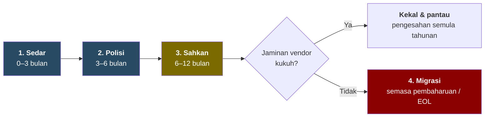

**TLP:GREEN** · 🇲🇾 Malaysia sahaja. Kongsi pautan, jangan siar semula. · Penilaian strategik · Keyakinan: Sederhana · [[my-only/2026-10-waze-ban-israel-nexus-technology|Read in English]]

> [!abstract] **BLUF (Intipati Utama)**
> **Waze dilarang untuk penjawat awam, tetapi rangkaian kerajaan bergantung pada alat yang mempunyai kaitan Israel lebih mendalam dan akses jauh lebih luas.**
> - **Apa berlaku:** pada **20 Okt 2026**, berdasarkan keputusan Jawatankuasa Keselamatan Siber Negara (JKSN) 3/2026, Ketua Setiausaha Negara melarang semua penjawat awam menggunakan Waze. PM pula menasihati orang awam beralih kepada aplikasi tempatan **TuJu**.
> - **Alasan kerajaan:** Waze *"tertakluk kepada undang-undang kerajaan Israel"*, sekali gus mendedahkan data dan pergerakan pengguna kepada risiko.
> - **Gunakan ujian yang sama ke atas semua yang lain**, dan Waze berada hampir di bawah sekali. Firewall, peti akses istimewa (PAM), SASE, EDR dan sensor OT daripada vendor yang diasaskan di Israel berada di dalam rangkaian kementerian dan CNII, dengan hak pentadbir dan kemas kini automatik.
> - **Jangan buang apa-apa secara mendadak.** Masukkan peraturan ke dalam polisi, minta vendor **menjamin secara bertulis bahawa tiada data Malaysia dihantar ke Israel**, sahkan jaminan itu, dan **tukar hanya semasa pembaharuan kontrak** jika mereka gagal berbuat demikian.

---

## Ringkasan pantas

| | |
| --- | --- |
| 🚫 **Dilarang** | Waze, untuk semua penjawat awam, berkuat kuasa serta-merta |
| ⚖️ **Ujiannya** | Adakah data Malaysia **dalam jangkauan undang-undang Israel**? |
| 🔓 **Alat berakses lebih tinggi yang memenuhinya** | Firewall, PAM, SASE, EDR, pemantauan OT (lihat di bawah) |
| ☁️ **Kes sukar** | Microsoft, Google dan AWS: penyedia awan kerajaan, semuanya ada R&D atau kontrak di Israel |
| ✅ **Tindakan** | Sedar → Polisi → Sahkan → Migrasi semasa pembaharuan |

---

## Jika Waze gagal ujian, alat-alat ini gagal lebih dahulu

Disusun mengikut **tahap akses di dalam rangkaian anda**, tertinggi dahulu:

| # | Kategori | Mengapa penting | Contoh berkait Israel |
| --- | --- | --- | --- |
| 1 | **SASE / secure web gateway** | *Semua* trafik anda melalui awan vendor | Cato Networks (ibu pejabat Israel). Zscaler dan Palo Alto (kedua-duanya ada R&D di Israel) |
| 2 | **Akses istimewa (PAM)** | Menyimpan kata laluan akaun pentadbir anda | CyberArk, kini Idira (diasaskan di Israel, milik Palo Alto Networks) |
| 3 | **Firewall / perimeter** | Inline pada setiap sambungan, kemas kini ditolak vendor | Check Point (ibu pejabat Israel). Palo Alto Networks (pengasas dan R&D Israel) |
| 4 | **EDR / XDR** | Ejen tahap kernel pada setiap komputer dan pelayan | SentinelOne, Cynet, Cybereason (diasaskan di Israel). CrowdStrike (pusat R&D di Israel) |
| 5 | **Pemantauan OT / IoT** | Melihat ke dalam sistem kawalan CNII | Claroty, Armis (diasaskan di Israel). Tenable OT (dibina atas Indegy, syarikat Israel) |
| 6 | **Keselamatan awan** | Membaca konfigurasi dan snapshot awan anda | Wiz (kini Google), Orca |
| … | **Aplikasi navigasi** | Data lokasi dan pergerakan | **Waze** |

Senarai penuh vendor beserta bukti ada di [[#Lampiran|Lampiran B]].

> [!tip] **Mengapa ini sukar**
> Kewarganegaraan pengasas ialah jalan buntu. Syarikat keselamatan terbesar Israel kini dimiliki firma AS, dan **Microsoft, Google dan AWS**, iaitu penyedia awan kerajaan, semuanya mempunyai R&D atau kontrak kerajaan di Israel. **Ke mana data anda pergi boleh disemak. Siapa pengasas vendor tidak boleh ditindaklanjuti.** Sebab itu langkah di bawah memberi tumpuan kepada aliran data.

---

## Apa perlu dilakukan: secara berperingkat, bukan mendadak

Membuang alat keselamatan di pertengahan kontrak adalah mahal, meninggalkan jurang yang digemari penyerang, dan boleh mencetuskan insiden yang cuba dielakkan (ingat [[my-threat-landscape/breaches/2026-06-fortibleed|FortiBleed]]). Lakukannya mengikut fasa:

**1. Sedar (0–3 bulan)**
- [ ] Senaraikan setiap produk keselamatan dan SaaS bersama **pemilik semasa**, **lokasi pembangunan dan sokongan**, **destinasi telemetri** dan **tarikh tamat kontrak**.
- [ ] Susun mengikut tahap akses, berpandukan jadual di atas.
- [ ] Sekat Waze pada peranti rasmi melalui MDM, dan kenakan kawalan sejarah lokasi ke atas **semua** aplikasi navigasi.

**2. Polisi (3–6 bulan)**
- [ ] Masukkan **klausa bidang kuasa data** dalam templat perolehan dan pembaharuan: tiada penyimpanan, pemprosesan atau akses data Malaysia di bidang kuasa yang disekat.
- [ ] Selaraskan dengan **Akta 854** (kewajipan NCII), panduan NACSA dan peraturan pemindahan rentas sempadan PDPA.

**3. Sahkan (6–12 bulan)**
- [ ] Dapatkan **jaminan bertulis** daripada setiap vendor yang merangkumi:
  - rantau data dan telemetri
  - **tiada akses dari Israel** (R&D, sokongan, penganalisis SOC, sub-pemproses)
  - senarai sub-pemproses dengan notis perubahan
  - laporan audit
  - bantuan keluar
- [ ] **Semak sendiri:** pantau ke mana ejen dan perkakas sebenarnya menghantar trafik, dan matikan ciri "perkongsian awan" pilihan.
- [ ] Beri **pemberat lebih rendah** kepada jaminan vendor beribu pejabat di Israel, kerana kontrak tidak boleh mengatasi undang-undang negara asal mereka.

**4. Migrasi (semasa pembaharuan atau tamat hayat)**
- [ ] Ganti **hanya** jika jaminan gagal. Selaraskan dengan tarikh pembaharuan untuk mengelak kos tenggelam.
- [ ] Jalankan sistem lama dan baharu secara selari, tukar semua kelayakan yang dipegang alat lama, dan buang akses jarak jauh vendor.
- [ ] Nilai alternatif tempatan, termasuk TuJu, melalui semakan keselamatan yang sama.

---

## Penilaian utama

| | Penilaian | Keyakinan |
| --- | --- | --- |
| **KJ-1** | Larangan ini **very likely** keputusan polisi yang dijustifikasikan atas alasan bidang kuasa data. **Tiada penemuan teknikal tentang Waze diterbitkan.** | Sederhana |
| **KJ-2** | Waze **almost certainly not** tempat paling berimpak untuk menggunakan ujian kerajaan sendiri. Alat keselamatan lebih utama. | Tinggi |
| **KJ-3** | Peraturan berasaskan kewarganegaraan pengasas tidak boleh dilaksanakan secara konsisten. **Peraturan aliran data boleh**, dan sebarang polisi yang lebih luas **very likely** berbentuk demikian. | Tinggi |
| **KJ-4** | Terdapat **roughly even chance** untuk panduan susulan melangkaui Waze dalam 6–12 bulan. | Rendah |
| **KJ-5** | Tindakan berperingkat dan disahkan mengurangkan pendedahan. **Penggantian mendadak mencetuskan risiko baharu.** | Tinggi |

---

## Mengapa Waze, dan mengapa sekarang?

Bukti paling sepadan dengan **keputusan polisi yang dijustifikasikan atas alasan keselamatan data**:
- Pekeliling menyebut Waze berpangkalan di Israel.
- PM menyebut undang-undang Israel serta data dan pergerakan rakyat Malaysia.
- Ia dipromosikan bersama alternatif tempatan.
- Ia menyusuli rampasan kargo ke Israel pada 2026 dan larangan perkapalan Israel pada 2023.

Yang menentang motif teknikal semata-mata ialah **Google Maps**, daripada syarikat induk yang sama dan jenis data yang sama, tidak disentuh. Iraq telah mengumumkan larangan Waze yang serupa, dan Iran pernah menyekat aplikasi ini. Penaakulan penuh ada di [[#Lampiran|Lampiran C]].

> [!warning] **Nota penggunaan wajar**
> Kaitan dengan Israel **bukan** bukti bahawa sesuatu produk berniat jahat atau mempunyai pintu belakang, dan tiada apa-apa di sini mendakwa salah laku oleh mana-mana vendor atau individu. Penilaian ini memetakan **pendedahan struktur** supaya organisasi Malaysia dapat bertindak balas terhadap polisi kerajaan yang dinyatakan. Pembetulan dialu-alukan melalui [[tanya-rectifyq/index|Tanya Rectifyq]] dan diterbitkan secara telus ([[methodology|Metodologi]]).

---

## Lampiran

> [!info]- **A. Arahan: apa yang diketahui**
> | Perkara | Butiran | Status |
> | --- | --- | --- |
> | Pengeluar | KSN Tan Sri Shamsul Azri Abu Bakar, pemberitahuan rasmi kepada perkhidmatan awam | ✅ Utusan, SoyaCincau |
> | Asas | Mesyuarat JKSN Bil. 3/2026, dipengerusikan PM Anwar Ibrahim | ✅ |
> | Skop | Semua anggota perkhidmatan awam, berkuat kuasa serta-merta. KSU dan Ketua Jabatan perlu memaklumkan ke bawah | ✅ |
> | Peranti | Rasmi atau peribadi **tidak dinyatakan** | ⚪ |
> | Penyelaras | NACSA, MKN, JPM | ✅ |
> | Nasihat awam | PM menasihati semua rakyat Malaysia menggunakan **TuJu** (Lembaga Lebuhraya Malaysia bersama Prosignal Consortium) | ✅ FMT, Malay Mail |
> | Rasional PM | Data peribadi dan maklumat pergerakan. Waze "tertakluk kepada undang-undang kerajaan Israel". *"Kerajaan tidak boleh berkompromi dalam soal keselamatan data dan identiti rakyat Malaysia"* (terjemahan) | ✅ FMT |
> | Mesyuarat sama | Keselamatan MyDigital ID, risiko AI autonomi | ✅ FMT |
> | Teks pekeliling | Tidak diterbitkan | ⚪ |
>
> **Latar belakang:**
> - Waze diasaskan di Israel pada 2008 dan dibeli Google pada 2013 (~US$1.15b). Ia digabungkan ke dalam pasukan Geo Google Maps mulai 2022, dan masih mempunyai pusat pembangunan di Israel.
> - Kira-kira **6 juta** rakyat Malaysia menggunakannya setiap bulan (anggaran 2017, FMT).
> - Seorang Ahli Parlimen Umno membangkitkan Waze dan Google Maps sebagai risiko keselamatan AS/Israel di Parlimen pada **2015**.

> [!example]- **B. Matriks vendor**
> **Bukti:** ✅ disahkan (sumber di Lampiran I) · 🟡 dilaporkan (bio vendor atau satu sumber) · ⚪ belum dinilai.
> **Dokumen vendor:** apa yang dinyatakan dalam **notis privasi (NP)** dan **senarai sub-pemproses (SP)** vendor sendiri tentang Israel, disemak pada **21 Okt 2026**. "Tiada sebutan" dalam notis privasi **tidak** bermaksud tiada data ke Israel. Senarai sub-pemproses dan lokasi sokongan lebih penting.
>
> **Tahap 1: Ibu pejabat di Israel**
>
> | Vendor | Kaitan | Pimpinan | Kehadiran di Malaysia | Dokumen vendor (Israel) |
> | --- | --- | --- | --- | --- |
> | **Check Point** | Ibu pejabat Tel Aviv ✅. Memiliki Perimeter 81 | CEO **Nadav Zafrir** (bekas komander Unit 8200) ✅. Pengerusi Eksekutif **Gil Shwed** (Unit 8200) ✅. Pengarah bebas utama Yoav Chelouche (Kor Risikan IDF) 🟡 | Pengedar JM Eastern, Ingram Micro. Peranti terdedah di Shadowserver | NP: menyebut Israel sebagai destinasi pemindahan ✅. SP: **sokongan utama diberikan dari Israel** ✅ |
> | **Cato Networks** | Ibu pejabat Tel Aviv ✅ | CEO **Shlomo Kramer** (Unit 8200) ✅ | **Gamuda**: 77 lokasi, 2,000+ pengguna jarak jauh menggunakan Cato SASE (Sep 2024) ✅. Shadowserver | NP: **tertakluk sepenuhnya kepada undang-undang Israel, mahkamah Tel Aviv**. Pengawal data Cato Networks Ltd, Tel Aviv (Feb 2025) ✅ |
> | **Radware** | Ibu pejabat Tel Aviv 🟡 | ⚪ | ⚪ | NP: tiada sebutan. Data disimpan di EU, AS dan rantau lain (Jun 2024) ✅ |
> | **Cymulate** | Israel ✅ | ⚪ | ⚪ | NP: **tertakluk kepada undang-undang Negara Israel** ✅ |
> | **Cybersixgill** | Israel ✅. Kini sebahagian BitSight | ⚪ | Melalui BitSight | Laman dialihkan ke BitSight |
> | **Ionix** | Israel/AS 🟡 | ⚪ | ⚪ | NP: merujuk Undang-undang Perlindungan Privasi Israel ✅ |
> | **Cellebrite** | Ibu pejabat Petah Tikva ✅ | ⚪ | Tiada bukti awam penggunaan di MY ✅ | ⚪ |
>
> **Tahap 2: Diasaskan di Israel, ibu pejabat di luar, R&D di Israel**
>
> | Vendor | Kaitan | Pimpinan | Kehadiran di Malaysia | Dokumen vendor (Israel) |
> | --- | --- | --- | --- | --- |
> | **CyberArk (kini Idira)** | Diasaskan di Israel ✅. **Milik Palo Alto Networks sejak Feb 2026, dijenamakan semula Idira pada Mei 2026** ✅ | Pengasas **Udi Mokady** (risikan tentera IDF) ✅ | ⚪ | Laman kini dialihkan ke Palo Alto Networks. NP: tiada sebutan |
> | **SentinelOne** | Diasaskan di Israel ✅. **Mengambil alih Prompt Security (Israel), Sep 2025** ✅ | CEO Tomer Weingarten: berkhidmat dalam IDF, *bukan* dalam unit teknologi atau risikan (temu bual beliau) ✅ | ⚪ | NP: tiada sebutan. SP: **Sentinel Labs Israel Ltd (Tel Aviv)** dan Monday.com Ltd (Israel) ✅ |
> | **Snyk** | Diasaskan di London/Tel Aviv ✅ | Pengasas Podjarny, Hefetz, Grander (Unit 8200) ✅. CEO Peter McKay | ⚪ | NP: tiada sebutan. SP: **Snyk Israel Limited, sokongan teknikal** ✅ |
> | **Wiz** | Diasaskan di Israel ✅. **Milik Google sejak Mac 2026** ✅ | CEO **Assaf Rappaport**: Talpiot, Unit 81, kapten dalam Unit 8200 ✅. Pengasas bersama juga Unit 8200 ✅ | ⚪ | NP (Google): **Wiz Cloud Ltd ialah pengawal data bagi data dari Israel** ✅ |
> | **Cybereason** | Diasaskan di Israel ✅. **Milik LevelBlue sejak Nov 2025** ✅ | Pengasas (Unit 8200) 🟡 | Penjual semula: Adellence | NP: tiada sebutan |
> | **Claroty** | Diasaskan di Israel, ibu pejabat New York 🟡 | Pengasas bersama Amir Zilberstein (unit siber IDF) 🟡 | Hantaran pengedar tentang sektor awam (Ishan Tech) | NP: data **boleh dipindahkan ke AS dan/atau Israel** ✅ |
> | **Cynet** | Diasaskan di Tel Aviv, ibu pejabat Boston ✅ | ⚪ | ⚪ | NP: merujuk undang-undang privasi Israel ✅ |
> | **Varonis** | Pengasas Israel, R&D Herzliya 🟡 | ⚪ | ⚪ | NP: data **dipindahkan, disimpan dan diproses** di negara termasuk Israel ✅ |
> | **Orca Security** | Diasaskan di Israel 🟡 | ⚪ | ⚪ | NP: **data peribadi dicapai dari Israel** ✅ |
> | **Aqua Security** | Ibu pejabat Ramat Gan. **Pusat R&D di Hyderabad, India** ✅ | ⚪ | Iklan jawatan majikan MY | NP: penyedia perkhidmatan di AS, Eropah, **Israel** ✅ |
> | **Intezer** | Diasaskan di Israel 🟡 | CEO Itai Tevet (bekas ketua IDF CERT) 🟡 | ⚪ | NP: data disimpan di AS, Eropah dan Israel 🟡 |
> | **Morphisec** | Israel 🟡 | ⚪ | ⚪ | NP: **akses dari Israel** ✅ |
> | **Coro** | Diasaskan di Israel 🟡 | ⚪ | ⚪ | NP: memproses data di AS, UK, EU, **Israel** ✅ |
> | **Forter** | Diasaskan di Israel (pencegahan penipuan) 🟡 | ⚪ | ⚪ | NP: Forter Ltd, Tel Aviv ✅ |
> | **Imperva** | Diasaskan di Israel. Milik Thales sejak 2023 | Pengasas bersama Kramer (Unit 8200) ✅ | ⚪ | NP: tiada sebutan |
> | **Armis** | Diasaskan di Israel. **Milik ServiceNow sejak Apr 2026** ✅ | ⚪ | ⚪ | NP: tiada sebutan |
> | **Guardicore** | Diasaskan di Israel. Milik Akamai sejak 2021 | ⚪ | ⚪ | ⚪ |
>
> **Tahap 3: Bukan Israel, dengan pengambilalihan atau R&D di Israel**
>
> | Vendor | Kaitan | Kehadiran di Malaysia | Dokumen vendor (Israel) |
> | --- | --- | --- | --- |
> | **Palo Alto Networks** | Pengasas/CTO **Nir Zuk** (Unit 8200) ✅. Pengambilalihan Israel termasuk Cyvera (Cortex XDR), Twistlock, Talon, Dig, **CyberArk** ✅ | Ya. Shadowserver | NP: tiada sebutan |
> | **Google** | **Waze**, Siemplify, **Wiz** ✅. R&D di Israel. Project Nimbus ✅ | Penyedia Rangka Kerja Awan kerajaan ✅ | NP: tiada sebutan (bagi Wiz, lihat di atas) |
> | **Microsoft** | R&D di Israel. Adallom, Aorato, Hexadite, CyberX. Memutuskan sebahagian perkhidmatan Azure IMOD, Sep 2025 ✅ | Penyedia Rangka Kerja Awan kerajaan ✅ | NP: tiada sebutan |
> | **AWS** | Annapurna Labs (reka bentuk cip Israel). Project Nimbus ✅ | Penyedia Rangka Kerja Awan kerajaan ✅ | ⚪ |
> | **CrowdStrike** | Pusat R&D di Israel (Ramat Gan). Preempt, Bionic, Flow, Adaptive Shield, **Seraphic (diumumkan Jan 2026)** ✅ | ⚪ | NP: syarikat sekutu **CrowdStrike Israel Ltd** dan **Flow Security Ltd (Israel)** ✅ |
> | **Zscaler** | R&D di Israel. Canonic, Trustdome, Avalor ✅ | ⚪ | SP: **sokongan diberikan dari Israel** antara negara lain ✅ |
> | **Rapid7** | Alcide, IntSights (2021), Minerva Labs (2023) ✅ | ⚪ | NP: tiada sebutan |
> | **Tenable** | Indegy (2019, Tenable OT), Ermetic (2023) ✅ | ⚪ | NP: tiada sebutan |
> | **Okta** | Spera (2023), Axiom (2025). Pusat R&D di Israel ✅ | ⚪ | NP: tiada sebutan |
> | **BitSight** | Cybersixgill (2024) ✅ | Pengedar TecD. Rakan kongsi Chubb MY | NP: tiada sebutan |
> | **Cisco** | R&D di Israel. Portshift (2020), Lightspin (2023) ✅ | Ya | NP: tiada sebutan |
> | **IBM** | IBM Research Haifa. Trusteer 🟡 | Ya | NP: tiada sebutan |
>
> **Tiada kaitan Israel yang ketara dikenal pasti:** Fortinet, Trend Micro, Recorded Future (Mastercard), Capgemini. Notis privasi mereka tidak menyebut Israel.

> [!question]- **C. Mengapa Waze? Hipotesis bersaing**
> | Bukti | H1 Isyarat polisi | H2 Bidang kuasa data | H3 Penemuan teknikal | H4 Semakan lebih luas | H5 Promosi aplikasi tempatan |
> | --- | --- | --- | --- | --- | --- |
> | Pekeliling menyebut "berpangkalan di Israel", tiada penemuan teknikal | K | K | T | N | N |
> | PM: "tertakluk kepada undang-undang kerajaan Israel", data dan pergerakan | N | K | N | N | N |
> | Diputuskan di JKSN, diselaraskan oleh NACSA | N | K | K | K | N |
> | Google Maps (syarikat induk sama) tidak disentuh | K | N | **T** | N | N |
> | Rampasan kargo 2026, larangan perkapalan 2023 | K | N | N | K | N |
> | Hanya Waze dinamakan | K | N | N | T | N |
> | TuJu dipromosikan pada hari yang sama | K | N | N | N | K |
> | MyDigital ID dalam agenda yang sama | N | K | N | K | N |
> | Duluan Iraq dan Iran | K | K | N | N | N |
> | **Ketidakselarasan** | **0** | **0** | **2** | **1** | **0** |
>
> *K = konsisten · T = tidak konsisten · N = neutral.*
>
> **Peguam syaitan:** jika bidang kuasa data benar-benar pendorongnya, undang-undang AS (cth. CLOUD Act) ke atas Google Maps dan penyedia awan kerajaan juga sepatutnya termasuk. Sikap selektif ini menunjukkan hujah bidang kuasa menjustifikasikan pilihan polisi, bukan hasil audit aliran data. Kedua-duanya mungkin benar, dan bagi pasukan pertahanan yang berguna ialah **ujian ini kini terbuka dan boleh digunakan ke atas pembekal**.

> [!note]- **D. Semakan andaian utama**
> | Andaian | Kukuh? | Sebab |
> | --- | --- | --- |
> | "Berkait dengan Israel" = risiko yang boleh diukur | ⚠️ Sebahagian | Bidang kuasa data boleh diukur. Kaitan semata-mata bukan bukti niat jahat |
> | Perkhidmatan pengasas dalam Unit 8200 ialah isyarat kuat | ❌ | Kerahan tentera hampir menyeluruh. Konteks sahaja |
> | Membuang vendor beribu pejabat Israel membuang kod Israel | ❌ | Kebanyakannya kini milik AS |
> | Tiada sebutan Israel dalam dasar privasi = tiada data di sana | ❌ | Semak sub-pemproses DPA dan akses sokongan. SentinelOne dan Snyk menunjukkan jurangnya |
> | Jaminan vendor sudah memadai | ⚠️ | Lebih lemah bagi vendor beribu pejabat Israel, kerana kontrak tidak boleh mengatasi undang-undang negara asal |
> | Alternatif tempatan lebih selamat | ⚠️ | Belum dinilai. "Tempatan" ≠ "disemak" |

> [!note]- **E. Tahap kaitan**
> | Tahap | Definisi | Contoh |
> | --- | --- | --- |
> | 1 | Ibu pejabat atau kawalan di Israel | Check Point, Cato, Radware, Cellebrite |
> | 2 | Diasaskan di Israel, ibu pejabat di luar, R&D teras di Israel | SentinelOne, Snyk, Claroty, Varonis |
> | 3 | Firma bukan Israel dengan pengambilalihan atau R&D Israel | Palo Alto, Google, CrowdStrike, Zscaler |
> | 4 | Kontrak dengan kerajaan atau tentera Israel | Google & AWS (Nimbus), Microsoft (IMOD) |
>
> **Risiko ≈ tahap × tahap akses × destinasi data.**

> [!note]- **F. Penunjuk untuk dipantau**
> | Jika kita lihat… | Maksudnya |
> | --- | --- |
> | Teks pekeliling diterbitkan, atau pekeliling kedua menamakan produk lain | Semakan lebih luas sedang berjalan (KJ-4 ↑) |
> | Panduan NACSA / Akta 854 tentang bidang kuasa data atau asal vendor | Peraturan aliran data sedang dibentuk (KJ-3 ✓) |
> | Pekeliling perolehan tentang lokasi data pembekal | Semakan lebih luas (KJ-4 ↑) |
> | Kenyataan teknikal tentang aliran data Waze | Motif keselamatan (KJ-1 ↓) |
> | Google Maps atau aplikasi lain turut disekat | Ujian bidang kuasa lebih luas |
> | Vendor menerbitkan komitmen residensi data Malaysia | Pasaran menyesuaikan diri (KJ-3 ✓) |
> | Tiada langkah melangkaui Waze dalam 6–12 bulan | Isyarat sahaja (KJ-4 ↓) |
>
> **Masih belum diketahui:** teks tepat dan skop peranti pekeliling, dan penggunaan sebenar vendor di atas dalam kerajaan. Kehadiran di Malaysia bermaksud kehadiran pasaran, bukan penggunaan kerajaan yang disahkan.

> [!note]- **G. Kaedah & bahasa anggaran**
> **Teknik digunakan:**
> - Semakan Andaian Utama
> - Analisis Hipotesis Bersaing
> - Pengkelasan tahap kaitan berstruktur
> - Penggredan sumber Admiralty
> - Peguam Syaitan
> - Penunjuk & Amaran
>
> **Kebarangkalian (ICD 203, istilah asal Bahasa Inggeris):** almost no chance (01–05%) · very unlikely (05–20%) · unlikely (20–45%) · roughly even chance (45–55%) · likely (55–80%) · very likely (80–95%) · almost certainly (95–99%). **Keyakinan** mencerminkan kualiti sumber, bukan kebarangkalian.

> [!note]- **H. Garis masa**
> | Tarikh | Peristiwa | Pautan |
> | --- | --- | --- |
> | 2013-06 | Google mengambil alih Waze | [FMT](https://www.freemalaysiatoday.com/category/nation/2026/10/20/anwar-advises-against-using-waze-over-israel-linked-security-concerns) |
> | 2015-11-26 | Ahli Parlimen Umno membangkitkan Waze dan Google Maps sebagai ancaman AS/Israel di Parlimen | [Malay Mail](https://www.malaymail.com/news/malaysia/2015/11/26/umno-mp-waze-google-maps-expose-malaysia-to-possible-us-israel-threats/1012269) |
> | 2021-02 | Microsoft, Google, Amazon, TM diluluskan sebagai penyedia awan sektor awam | [NST](https://www.nst.com.my/news/nation/2021/02/666988/four-csps-build-manage-hyper-scale-data-centres-cloud-services) |
> | 2022-05 | Perjanjian Rangka Kerja Awan ditandatangani (MAMPU) | [Business Today](https://www.businesstoday.com.my/2022/05/09/public-sector-data-centre-upgraded-to-mygovcloud/) |
> | 2023-12 | Larangan kapal milik/berbendera Israel dan ZIM | [CNN](https://www.cnn.com/2023/12/20/asia/malaysia-israel-shipping-ban-palestine-support-intl-hnk) |
> | 2025-09 | Microsoft menyahaktifkan perkhidmatan Azure IMOD tertentu | [NBC News](https://www.nbcnews.com/tech/tech-news/microsoft-ends-israel-military-units-access-cloud-service-rcna233723) |
> | 2025-11-25 | LevelBlue melengkapkan pengambilalihan Cybereason | [Cybereason](https://www.cybereason.com/press/levelblue-acquires-cybereason) |
> | 2026-02-11 | Palo Alto Networks melengkapkan pengambilalihan CyberArk | [SEC 8-K](https://www.sec.gov/Archives/edgar/data/1327567/000119312526045600/d40626dex991.htm) |
> | 2026-03-11 | Google melengkapkan pengambilalihan Wiz | [Cleary Gottlieb](https://www.clearygottlieb.com/news-and-insights/news-listing/google-completes-32-billion-acquisition-of-wiz) |
> | 2026-04-20 | ServiceNow melengkapkan pengambilalihan Armis | [Verdict](https://www.verdict.co.uk/servicenow-completes-armis-deal/) |
> | 2026-09-15 | PM: tiada kargo yang membantu ketenteraan Israel melalui Malaysia | [FMT](https://www.freemalaysiatoday.com/category/nation/2026/09/15/malaysia-won-t-allow-cargo-aiding-israel-s-military-says-anwar) |
> | **2026-10-20** | **Waze dilarang untuk penjawat awam. PM mempromosikan TuJu** | [Utusan](https://www.utusan.com.my/nasional/2026/10/penjawat-awam-dilarang-guna-aplikasi-waze/) · [FMT](https://www.freemalaysiatoday.com/category/nation/2026/10/20/anwar-advises-against-using-waze-over-israel-linked-security-concerns) · [Malay Mail](https://www.malaymail.com/news/malaysia/2026/10/20/from-waze-to-tuju-anwar-backs-local-app-over-data-security-concerns/239923) · [SoyaCincau](https://soyacincau.com/2026/10/21/malaysian-goverment-bans-waze-civil-servants/) |

> [!quote]- **I. Rujukan & penggredan sumber**
> | Sumber | Digunakan untuk | Gred |
> | --- | --- | --- |
> | [Utusan Malaysia](https://www.utusan.com.my/nasional/2026/10/penjawat-awam-dilarang-guna-aplikasi-waze/) | Pekeliling, skop | B2 |
> | [SoyaCincau](https://soyacincau.com/2026/10/21/malaysian-goverment-bans-waze-civil-servants/) | Butiran pekeliling | B2 |
> | [FMT](https://www.freemalaysiatoday.com/category/nation/2026/10/20/anwar-advises-against-using-waze-over-israel-linked-security-concerns) | Rasional PM, Iraq/Iran, bilangan pengguna | B2 |
> | [Malay Mail](https://www.malaymail.com/news/malaysia/2026/10/20/from-waze-to-tuju-anwar-backs-local-app-over-data-security-concerns/239923) | Nasihat TuJu | B2 |
> | [Palo Alto Networks 8-K](https://www.sec.gov/Archives/edgar/data/1327567/000119312526045600/d40626dex991.htm) | CyberArk | A1 |
> | [24/7 Wall St](https://247wallst.com/investing/2026/05/15/oppenheimer-hikes-palo-alto-networks-price-target-to-275-cyberark-becomes-idira-identity-security-just-got-real/) | CyberArk → Idira | B2 |
> | [Cleary Gottlieb](https://www.clearygottlieb.com/news-and-insights/news-listing/google-completes-32-billion-acquisition-of-wiz) | Wiz | A1 |
> | [NBC News](https://www.nbcnews.com/tech/tech-news/microsoft-ends-israel-military-units-access-cloud-service-rcna233723) | Microsoft / IMOD | A2 |
> | [Cybereason](https://www.cybereason.com/press/levelblue-acquires-cybereason) | LevelBlue | A1 |
> | [Verdict](https://www.verdict.co.uk/servicenow-completes-armis-deal/) | Armis | B2 |
> | [Cato Networks: Gamuda](https://www.catonetworks.com/news/gamuda-transforms-it-operations-with-cato/) · [IT Security Guru](https://www.itsecurityguru.org/2024/09/24/gamuda-transforms-it-operations-with-cato-networks/) | Penggunaan Gamuda | B2 (vendor) |
> | [Kepimpinan Check Point](https://www.checkpoint.com/about-us/leadership/) | Zafrir, Shwed, Chelouche | A1 |
> | [Wikipedia: Yoav Chelouche](https://en.wikipedia.org/wiki/Yoav_Chelouche) | Kor Risikan | C2 |
> | [Fortune](https://fortune.com/2016/09/13/israeli-security-software-cato) | Kramer | B2 |
> | [Globes: Snyk](https://en.globes.co.il/en/article-open-source-security-platform-snyk-raises-70m-1001300189) | Pengasas Snyk | B2 |
> | [Wikipedia: Udi Mokady](https://en.wikipedia.org/wiki/Udi_Mokady) | Mokady | C2 |
> | [Wikipedia: Assaf Rappaport](https://en.wikipedia.org/wiki/Assaf_Rappaport) · [Calcalist: Wiz](https://www.calcalistech.com/ctechnews/article/sjltwsk2kg) | Rappaport, pengasas Wiz | B2 |
> | [Calcalist: temu bual Weingarten](https://www.calcalistech.com/ctech/articles/0,7340,L-3917654,00.html) | Perkhidmatan Weingarten | B2 |
> | [SentinelOne 10-Q](https://www.sec.gov/Archives/edgar/data/1583708/000158370825000159/s-20251031.htm) | Pengambilalihan Prompt Security | A1 |
> | [Halaman hubungan Aqua Security](https://www.aquasec.com/about-us/contact-us/) | R&D Hyderabad | A1 |
> | [Globes: CrowdStrike](https://en.globes.co.il/en/article-1001493338) · [Flow](https://en.globes.co.il/en/article-1001467832) · [SecurityWeek: Seraphic](https://www.securityweek.com/crowdstrike-to-acquire-browser-security-firm-seraphic-for-420-million/) | CrowdStrike Israel | B2 |
> | [Globes: Zscaler](https://en.globes.co.il/en/article-1001367956) · [Ynet: Avalor](https://ynetnews.com/business/article/sjapmefaa) | Zscaler Israel | B2 |
> | [Calcalist: Lightspin](https://calcalistech.com/ctechnews/article/sk11dn511113) | Cisco | B2 |
> | [Globes: Axiom](https://en.globes.co.il/en/article-1001519918) · [SecurityWeek: Spera](https://www.securityweek.com/okta-to-acquire-israeli-startup-spera-security/) | Okta | B2 |
> | [Globes: Indegy](https://en.globes.co.il/en/article-1001309487) · [Globes: Ermetic](https://en.globes.co.il/en/article-tenable-confirms-acquisition-of-israeli-cloud-security-co-ermetic-1001457403) | Tenable | B2 |
> | [Boston Globe: IntSights](https://www.bostonglobe.com/2021/07/19/business/rapid7-acquires-israel-founded-cybersecurity-firm-335-million) · [Calcalist: Rapid7](https://www.calcalistech.com/tags/Rapid_7) | Rapid7 | B2 |
> | [Wikipedia: Cynet](https://en.wikipedia.org/wiki/Cynet_(company)) · [SentinelOne](https://en.wikipedia.org/wiki/SentinelOne) · [Cellebrite](https://en.wikipedia.org/wiki/Cellebrite) | Latar belakang syarikat | C2 |
> | Notis privasi vendor: [Check Point](https://www.checkpoint.com/privacy/) · [Cato](https://www.catonetworks.com/privacypolicy/) · [Radware](https://www.radware.com/privacypolicy/) · [Cymulate](https://cymulate.com/privacy-policy/) · [Ionix](https://www.ionix.io/privacy-policy/) · [Claroty](https://claroty.com/privacy-policy) · [Cynet](https://www.cynet.com/privacy-policy/) · [Varonis](https://www.varonis.com/privacy-policy) · [Orca](https://orca.security/privacy-policy/) · [Aqua](https://www.aquasec.com/privacy/) · [Morphisec](https://www.morphisec.com/privacy-policy) · [Coro](https://www.coro.net/privacy-policy) · [Forter](https://www.forter.com/privacy-policy/) · [CrowdStrike](https://www.crowdstrike.com/en-us/legal/privacy-notice/) · [Google (Wiz)](https://cloud.google.com/terms/cloud-acquisitions-privacy-notice) | Sebutan Israel, disemak 21 Okt 2026 | A1 |
> | Senarai sub-pemproses: [Check Point](https://www.checkpoint.com/sub-processors-list/) · [SentinelOne](https://www.sentinelone.com/legal/sentinelone-sub-processors/) · [Snyk](https://snyk.io/policies/subprocessors/) · [Zscaler](https://www.zscaler.com/privacy-compliance/subprocessors) | Entiti dan sokongan Israel | A1 |
> | [Citizen Lab (2018)](https://citizenlab.ca/2018/09/hide-and-seek-tracking-nso-groups-pegasus-spyware-to-operations-in-45-countries/) | NSO: Malaysia tiada dalam 45 negara | A1 |
> | [Shadowserver (MY)](https://dashboard.shadowserver.org/statistics/iot-devices/map/?date_range=1&vendor=check+point&geo=MY&data_set=count&scale=log&auto_update=on) | Pendedahan MY agregat | A2 |
> | [Globes: Waze](https://en.globes.co.il/en/article-google-cuts-jobs-at-waze-due-to-ads-merger-1001450663) | Waze dalam Google | B2 |
>
> *Admiralty: A–F kebolehpercayaan sumber, 1–6 kredibiliti maklumat.*
