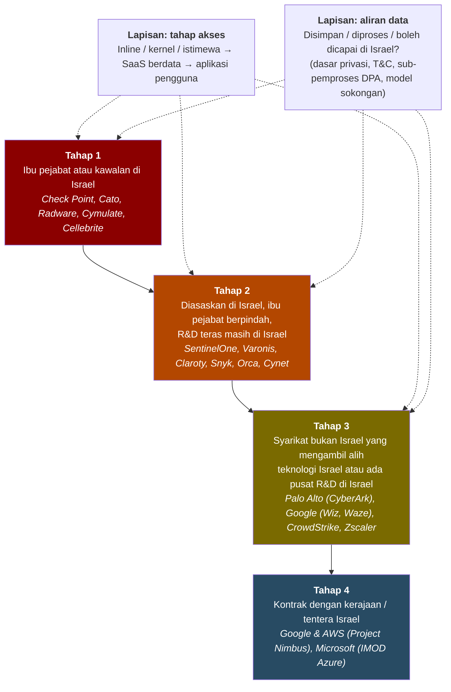
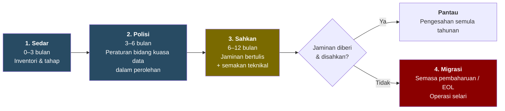

**Status:** Arahan disahkan oleh dua sumber (Utusan, SoyaCincau) · **Jenis:** Penilaian strategik · **Keyakinan keseluruhan:** Sederhana · **TLP:GREEN** · 🇲🇾 Malaysia sahaja · [[my-only/2026-10-waze-ban-israel-nexus-technology|English version]]

> [!warning] **TLP:GREEN**
> Boleh dikongsi dalam komuniti keselamatan siber Malaysia dan organisasi rakan. Jangan siar semula secara terbuka atau di luar Malaysia. Kongsikan pautan ke halaman ini sahaja.

> [!abstract] **BLUF (Intipati Utama)**
> - **Dua langkah pada hari yang sama (20 Okt 2026):**
>   - **Pemberitahuan rasmi yang mengikat** daripada Ketua Setiausaha Negara (KSN) melarang **penjawat awam** menggunakan **Waze** berkuat kuasa serta-merta, berdasarkan keputusan Jawatankuasa Keselamatan Siber Negara (JKSN) Bil. 3/2026, dengan NACSA sebagai agensi penyelaras.
>   - **Nasihat awam** daripada Perdana Menteri Anwar Ibrahim menggesa semua rakyat Malaysia beralih kepada aplikasi tempatan **TuJu**.
> - **Rasional yang dinyatakan ialah bidang kuasa ke atas data.** PM menyebut data peribadi dan maklumat pergerakan pengguna, dan menyatakan Waze **tertakluk kepada undang-undang kerajaan Israel**. Jika diterbalikkan, ini menjadi soalan yang boleh diuji bagi setiap pembekal lain: **adakah data Malaysia disimpan atau diproses di Israel, atau boleh dicapai dari sana?**
> - **Berdasarkan ujian itu, Waze berada di kedudukan rendah.** **Produk keselamatan** yang beribu pejabat atau diasaskan di Israel (firewall, pengurusan akses istimewa, SASE, pemantauan OT, EDR) berada di dalam rangkaian kerajaan dan CNII. Produk ini memegang akses pentadbir dan saluran kemas kini automatik, serta menghantar telemetri kembali kepada vendor. *(Keyakinan tinggi)*
> - **Ujian berdasarkan kewarganegaraan pengasas tidak dapat dilaksanakan secara konsisten.** Penyedia awan hiperskala dalam Perjanjian Rangka Kerja Awan sektor awam (**Microsoft, Google, AWS**) semuanya mempunyai R&D, pengambilalihan atau kontrak kerajaan Israel, dan **Google memiliki Waze sejak 2013**. **Ujian aliran data boleh dilaksanakan**, kerana ia boleh disemak melalui kontrak dan trafik rangkaian. *(Keyakinan tinggi)*
> - **Cadangan: sedar dahulu, kemudian bertindak secara berperingkat.** Penggantian mendadak alat keselamatan adalah mahal dan menimbulkan risiko. Sebaliknya, **masukkan ke dalam polisi, dapatkan jaminan bertulis vendor bahawa tiada data dihantar ke Israel, dan sahkan jaminan itu**. Rancang sebarang migrasi **semasa pembaharuan kontrak atau tamat hayat produk**. Lihat [[#Apa maksudnya untuk Malaysia? 🇲🇾|pelan berperingkat]].

---

## Soalan Risikan Utama (KIQ)

1. **KIQ-1:** Apakah sebenarnya yang diputuskan, untuk siapa, dan atas asas apa?
2. **KIQ-2:** Teknologi lain manakah dalam penggunaan sektor awam yang memenuhi ujian yang sama, dan setakat mana aksesnya?
3. **KIQ-3:** Adakah keputusan ini didorong oleh penemuan teknikal, kebimbangan bidang kuasa data, polisi dan solidariti, atau gabungan?
4. **KIQ-4:** Apakah langkah susulan yang mungkin, dan apa yang perlu dilakukan oleh pertahanan siber Malaysia sekarang?

---

## Apa yang diketahui (KIQ-1)

| Perkara | Butiran | Status |
| --- | --- | --- |
| Pengeluar (mengikat) | KSN Tan Sri Shamsul Azri Abu Bakar, pemberitahuan rasmi kepada perkhidmatan awam | ✅ Disahkan (Utusan, SoyaCincau) |
| Asas | Mesyuarat JKSN Bil. 3/2026, dipengerusikan oleh PM Anwar Ibrahim | ✅ Disahkan |
| Skop (mengikat) | Semua anggota perkhidmatan awam, berkuat kuasa serta-merta. KSU dan Ketua Jabatan perlu memaklumkan hingga ke peringkat agensi | ✅ Disahkan |
| Skop peranti | **Peranti rasmi atau peribadi tidak dinyatakan** | ⚪ Jurang |
| Sebab dalam pemberitahuan | Waze "berpangkalan di Israel" / berkait dengan Israel | ✅ Disahkan |
| Nasihat awam | PM menasihati **semua rakyat Malaysia** supaya tidak menggunakan Waze dan mempromosikan **TuJu** (oleh Lembaga Lebuhraya Malaysia, dibangunkan bersama Prosignal Consortium) | ✅ FMT, Malay Mail |
| Rasional PM | Data peribadi dan maklumat pergerakan pengguna. Waze "tertakluk kepada undang-undang kerajaan Israel". *"Kerajaan tidak boleh berkompromi dalam soal keselamatan data dan identiti rakyat Malaysia"* (terjemahan) | ✅ FMT |
| Mesyuarat yang sama | Keselamatan MyDigital ID dan risiko AI autonomi | ✅ FMT |
| Penyelaras | NACSA, MKN, JPM | ✅ Disahkan |
| Nombor / teks pekeliling | Tidak diterbitkan | ⚪ Jurang |

**Konteks:**
- **Pemilikan Waze:** diasaskan di Israel pada 2008 dan diambil alih oleh **Google pada Jun 2013** dengan nilai kira-kira US$1.15 bilion. Pasukannya digabungkan ke dalam organisasi Geo Google (Google Maps) mulai **Dis 2022**, dan ia masih mempunyai pusat pembangunan di Israel.
- **Penggunaan:** anggaran 2017 meletakkan pengguna bulanan Waze di Malaysia pada **kira-kira 6 juta**, menurut FMT.
- **Duluan serantau:** **Iraq** telah mengumumkan larangan penuh Waze mulai awal 2027 atas faktor asal Israel dan keselamatan data, dan **Iran** pernah menyekatnya (kedua-duanya menurut FMT).
- **Duluan tempatan:** pada **2015**, seorang Ahli Parlimen Umno memberitahu Parlimen bahawa Waze dan Google Maps mendedahkan Malaysia kepada ancaman AS dan Israel. Kerajaan ketika itu menjawab bahawa penggunaannya adalah pilihan (Malay Mail).

---

## Kaedah analisis

| SAT | Tujuan |
| --- | --- |
| **Semakan Andaian Utama** | Mendedahkan apa yang mesti benar supaya polisi "sekat teknologi berkait Israel" berkesan |
| **Analisis Hipotesis Bersaing (ACH)** | Menguji *mengapa* Waze dipilih (KIQ-3) |
| **Pengkelasan tahap kaitan berstruktur** | Menggantikan "berkait / tidak berkait" dengan kriteria bertingkat serta tahap akses (KIQ-2) |
| **Penggredan sumber (Admiralty)** | Setiap rujukan digred. Bio vendor ≠ pengesahan bebas |
| **Peguam Syaitan (Devil's Advocacy)** | Membentangkan hujah terkuat *menentang* hipotesis utama |
| **Penunjuk & Amaran** | Tanda yang boleh dilihat yang akan mengubah penilaian |

> [!info] **Bahasa anggaran** (ICD 203)
> hampir tiada kemungkinan (01–05%) · sangat tidak mungkin (05–20%) · tidak mungkin (20–45%) · peluang hampir sama (45–55%) · mungkin (55–80%) · sangat mungkin (80–95%) · hampir pasti (95–99%).
> **Keyakinan** (Tinggi / Sederhana / Rendah) mencerminkan kualiti dan pengesahan sumber, *bukan* kebarangkalian.

---

## Semakan Andaian Utama

| # | Andaian | Kukuh? | Ulasan |
| --- | --- | --- | --- |
| A1 | "Berkait dengan Israel" bermaksud risiko yang boleh diukur | ⚠️ Sebahagian | Kerangka kerajaan sendiri ialah **bidang kuasa undang-undang ke atas data**. Ini *boleh* diukur (di mana data disimpan, siapa boleh mencapainya). Kaitan semata-mata **bukan** bukti keupayaan berniat jahat |
| A2 | Perkhidmatan risikan IDF pengasas (cth. Unit 8200) ialah pembeza yang kuat | ❌ Lemah | Kerahan tentera hampir menyeluruh di Israel, dan alumni 8200 sangat ramai dalam industri. Berguna sebagai konteks, lemah sebagai kriteria tunggal |
| A3 | Membuang vendor beribu pejabat di Israel bermakna membuang kod yang dibangunkan di Israel | ❌ Tidak | Banyak teknologi Israel **kini dimiliki syarikat AS** (Palo Alto Networks, Google, CrowdStrike, Zscaler, Microsoft, ServiceNow) |
| A4 | Jika dasar privasi tidak menyebut Israel, tiada data mengalir ke sana | ❌ Tidak | Semak **senarai sub-pemproses DPA**, akses sokongan "follow-the-sun", dan akses R&D kepada telemetri serta crash dump. SentinelOne dan Snyk menyenaraikan **entiti Israel dalam DPA** walaupun dasar privasi mereka tidak menyebut Israel |
| A5 | Jaminan bertulis vendor sudah memadai | ⚠️ Bergantung | Kontrak tidak boleh mengatasi undang-undang akses paksa **di negara asal vendor**. Jaminan daripada vendor **Tahap 1** (ibu pejabat Israel) mempunyai **tahap kepastian lebih rendah** berbanding vendor Tahap 3 yang boleh mengasingkan data di luar Israel |
| A6 | Pekeliling meliputi peranti peribadi | ⚪ Tidak diketahui | Tidak dinyatakan |
| A7 | Alternatif tempatan berisiko lebih rendah | ⚠️ Belum diuji | Tiada penilaian keselamatan awam ke atas TuJu ditemui. "Tempatan" ≠ "telah dinilai" |

---

## Analisis Hipotesis Bersaing (ACH)

**Hipotesis:**
- **H1:** Isyarat polisi/solidariti, selari dengan langkah lebih luas Malaysia terhadap Israel.
- **H2:** Kebimbangan keselamatan data dari sudut bidang kuasa (undang-undang Israel menjangkau data dan pergerakan pengguna Malaysia).
- **H3:** Penemuan teknikal khusus tentang Waze (kerentanan, insiden atau analisis telemetri).
- **H4:** Langkah pembukaan kepada semakan lebih luas teknologi berkait Israel.
- **H5:** Dasar industri untuk mempromosikan platform tempatan (TuJu).

| Bukti | Gred | H1 | H2 | H3 | H4 | H5 |
| --- | --- | --- | --- | --- | --- | --- |
| E1: Pemberitahuan menyebut Waze berpangkalan di Israel. Tiada kerentanan, insiden atau penemuan data disebut | B2 | K | K | T | N | N |
| E2: PM menyebut data peribadi dan pergerakan, serta "tertakluk kepada undang-undang kerajaan Israel" | B2 | N | K | N | N | N |
| E3: Diputuskan di JKSN dan diselaraskan oleh NACSA (jentera siber) | B2 | N | K | K | K | N |
| E4: Google Maps dan Google Cloud (syarikat induk sama) **tidak** termasuk | A1 | K | N | **T** | N | N |
| E5: Konteks 2026: rampasan kargo ke Israel (Ogos), ikrar PM 15 Sep, larangan kapal ZIM/Israel 2023 | A1 | K | N | N | K | N |
| E6: Hanya Waze dinamakan | B2 | K | N | N | T | N |
| E7: TuJu dipromosikan pada hari yang sama, kepada orang awam | B2 | K | N | N | N | K |
| E8: Mesyuarat yang sama membincangkan MyDigital ID dan risiko AI (agenda kedaulatan data) | B2 | N | K | N | K | N |
| E9: Duluan serantau (Iraq, Iran) menyebut asal Israel dan keselamatan data | B2 | K | K | N | N | N |
| **Ketidakselarasan (lebih rendah = lebih baik)** | | **0** | **0** | **2** | **1** | **0** |

*K = konsisten, T = tidak konsisten, N = neutral.*

**Keputusan:** **H1 dan H2 bersama-sama** paling menjelaskan bukti: **keputusan polisi yang dijustifikasikan atas alasan keselamatan data dari sudut bidang kuasa**. **H5** ialah pendorong sokongan. **H3 paling kurang disokong**, kerana tiada penemuan teknikal diterbitkan, dan kebimbangan berasaskan telemetri sepatutnya turut terpakai kepada Google Maps. **H4 masih terbuka**, dan penunjuk di bawah mengujinya.

> [!question] **Peguam Syaitan: hujah menentang H2**
> Jika bidang kuasa ke atas data benar-benar pendorongnya, logik yang sama menjangkau undang-undang **AS** (cth. CLOUD Act) ke atas **Google Maps**, Google Cloud dan penyedia Rangka Kerja Awan yang lain, yang tidak disentuh. Data Waze diproses oleh Google, jadi sama ada "undang-undang Israel" terpakai bergantung pada lokasi data dan siapa yang boleh mencapainya, dan ini belum ditunjukkan secara terbuka. Sikap selektif ini menunjukkan hujah bidang kuasa **lebih merupakan justifikasi kepada pilihan polisi (H1)** daripada hasil audit aliran data. *Pandangan kami:* kedua-duanya benar serentak. Bagi pasukan pertahanan, yang penting ialah **kerajaan telah menerima pakai secara terbuka ujian bidang kuasa data**, dan ujian itu boleh digunakan ke atas pembekal.

---

## Pengkelasan tahap kaitan berstruktur (KIQ-2)

**Risiko ≈ Tahap kaitan × Tahap akses × Aliran data.** Firewall Tahap 3 yang berada inline di rangkaian kementerian dan menghantar telemetri kepada pasukan R&D di Israel memerlukan penelitian lebih rapi berbanding alat Tahap 1 yang datanya diasingkan secara kontrak di rantau ini.

---

## Matriks vendor yang disahkan

**Petunjuk:**
- ✅ Disahkan dalam semakan ini (sumber dinyatakan)
- 🟡 Dilaporkan (bio vendor, sekunder atau satu sumber)
- ❌ Dakwaan draf awal tidak disokong / diperbetulkan
- ⚪ Belum dinilai

**Dok. undang-undang** = Israel disebut dalam **Dasar Privasi / T&C-ToU-EULA / DPA (sub-pemproses)**, daripada semakan dokumen Rectifyq sendiri (Y = ya, N = tidak, – = belum disemak). Semakan ini belum diulang untuk versi ini, dan vendor kerap mengemas kini dokumen tersebut.

### Tahap 1: Ibu pejabat di Israel

| Vendor | Kaitan Israel | Kaitan unit risikan pimpinan | Bukti di Malaysia | Dok. undang-undang | Nota / pembetulan |
| --- | --- | --- | --- | --- | --- |
| **Check Point** | Ibu pejabat Tel Aviv (ibu pejabat AS di San Carlos) ✅. Mengambil alih Perimeter 81 (2023) | **Nadav Zafrir**, CEO sejak Dis 2024, bekas komander Unit 8200 ✅. **Gil Shwed**, Pengerusi Eksekutif, Unit 8200 ✅ | Pengedar JM Eastern, Ingram Micro MY. Pendedahan MY (agregat) di Shadowserver | Y / Y / – | ❌ Jerry Ungerman sebagai Pengerusi sudah lapuk. ❌ **Amnon Shoshani ialah pengarah CyberArk, bukan Check Point.** Kaitannya dengan "Unit Jurucakap IDF" tidak disokong. Yoav Chelouche, Kor Risikan 🟡 |
| **Cato Networks** | Ibu pejabat Tel Aviv ✅ | **Shlomo Kramer**, pengasas bersama/CEO, Unit 8200 ✅. Gur Shatz: tiada ditemui | Kisah pelanggan menamakan Gamuda 🟡. Pendedahan MY di Shadowserver | Y / – / – | SASE: **semua trafik melalui awan vendor** |
| **Radware** | Ibu pejabat Tel Aviv 🟡 | ⚪ | ⚪ | N / Y / – | DDoS/WAF, inline |
| **Cymulate** | Diasaskan/ibu pejabat di Israel 🟡 | ⚪ | ⚪ | Y / Y / – | Simulasi serangan: **ejen menjalankan serangan dalam rangkaian anda** |
| **Cybersixgill** | Israel ✅. **Diambil alih BitSight (2024)** | ⚪ | Melalui BitSight | Y / Y / – | Risikan ancaman |
| **Ionix** (dahulu Cyberpion) | Israel/AS 🟡 | ⚪ | ⚪ | Y / Y / – | Pengurusan permukaan serangan |
| **Cellebrite** *(tambahan)* | Ibu pejabat Petah Tikva ✅. Pemegang saham terbesar Sun Corp (Jepun) | ⚪ | **Tiada bukti awam penggunaan di MY** ✅ | – | Disenaraikan untuk kelengkapan, tiada dakwaan MY dibuat |

### Tahap 2: Diasaskan di Israel, ibu pejabat di luar, R&D teras di Israel

| Vendor | Kaitan Israel | Kaitan unit risikan pimpinan | Bukti di Malaysia | Dok. undang-undang | Nota / pembetulan |
| --- | --- | --- | --- | --- | --- |
| **CyberArk** | Diasaskan di Petah Tikva ✅. **Dimiliki Palo Alto Networks sejak 11 Feb 2026** ✅ | **Udi Mokady**, pengasas, risikan tentera IDF ✅. "Unit 8200" 🟡 | ⚪ | Tidak langsung (pejabat) / Y / – | PAM: **memegang kunci akaun pentadbir**. ❌ "Gadi Tirosh – mungkin IDF" dibuang kerana tidak bermaklumat |
| **SentinelOne** | Diasaskan di Israel 2013 ✅. Mengambil alih Prompt Security 🟡 | Tomer Weingarten: ❌ kaitan tentera **tidak ditemui** dalam sumber | ⚪ | N / N / **Y (Prompt Security Ltd, Israel)** | EDR, ejen kernel. **Contoh jelas A4**: DPA mendedahkan apa yang tidak disebut dalam dasar privasi |
| **Snyk** | Diasaskan di London & Tel Aviv 2015, ibu pejabat Boston ✅. Mengambil alih Helios 🟡 | **Podjarny, Hefetz, Grander**: Unit 8200 ✅ | ⚪ | N / N / **Y (Snyk Israel Ltd)** | ❌ **CEO ialah Peter McKay (sejak 2019)**, bukan Podjarny |
| **Wiz** | Diasaskan di Israel ✅. **Dimiliki Google sejak 11 Mac 2026** ✅ | Keempat-empat pengasas Unit 8200 🟡 | ⚪ | Y / N / – | ❌ "Talpiot" bagi Rappaport tidak disahkan |
| **Cybereason** | Diasaskan di Israel 2012 ✅. **Dimiliki LevelBlue sejak 25 Nov 2025** ✅ | Pengasas Div, Naar, Striem-Amit: Unit 8200 🟡 | Penjual semula (Adellence) | N / N / – | ❌ Pengasas, bukan bekas CISO, ialah kaitan yang relevan |
| **Claroty** | Diasaskan di Israel (Team8), ibu pejabat New York 🟡 | Amir Zilberstein, "unit siber elit IDF" 🟡 | Hantaran pengedar berkaitan **sektor awam** (Ishan Tech) | Y / Y / – | **Pemantauan OT/CNII**, lihat [[ics-ot/index\|ICS/OT]] |
| **Cynet** | Diasaskan di Tel Aviv 2015, ibu pejabat Boston ✅ | ❌ Eyal Gruner "Unit 8200" **tidak disokong** | ⚪ | Y / Y / – | EDR/XDR |
| **Varonis** | Diasaskan oleh Faitelson & Korkus, R&D di Herzliya 🟡 | ⚪ | ⚪ | Y / N / – | Membaca kebenaran dan kandungan fail |
| **Orca Security** | Diasaskan di Israel 🟡 | ⚪ | ⚪ | Y / Y / – | Keselamatan awan (membaca snapshot awan) |
| **Aqua Security** | Ibu pejabat Israel (Ramat Gan). R&D di India menurut koleksi kami 🟡 | Dror Davidoff (CEO): tiada dikenal pasti | Pihak permintaan sahaja: iklan jawatan majikan MY | Y / Y / – | Kehadiran MY: tiada ditemui |
| **Intezer** | Diasaskan di Israel, ibu pejabat New York 🟡 | **Itai Tevet**, bekas ketua IDF CERT 🟡 | ⚪ | Y / Y / – | |
| **Morphisec** | Diasaskan/ibu pejabat di Israel (Be'er Sheva) 🟡 | ⚪ | ⚪ | Y / Y / – | Endpoint |
| **Coro** | Diasaskan di Israel (Coronet), ibu pejabat Chicago 🟡 | ⚪ | ⚪ | Y / Y / – | Keselamatan PKS |
| **Forter** | Diasaskan di Israel, ibu pejabat New York 🟡 | ⚪ | ⚪ | Y (alamat pejabat) / N / – | Pencegahan penipuan. **Relevan rendah kepada kerajaan** |
| **Imperva** *(tambahan)* | Diasaskan di Israel. **Dimiliki Thales (Perancis) sejak 2023** | Kramer (pengasas bersama): Unit 8200 ✅ | ⚪ | – | WAF/DDoS, inline |
| **Armis** *(tambahan)* | Diasaskan di Israel. **Dimiliki ServiceNow sejak 20 Apr 2026** ✅ | ⚪ | ⚪ | – | IoT/OT/perubatan: **relevan kepada CNII** |
| **Guardicore** *(tambahan)* | Diasaskan di Israel. Dimiliki Akamai (2021) | ⚪ | ⚪ | – | Segmentasi mikro |

### Tahap 3: Syarikat bukan Israel dengan pengambilalihan atau R&D di Israel

| Vendor | Kaitan Israel | Bukti di Malaysia | Dok. undang-undang | Nota / pembetulan |
| --- | --- | --- | --- | --- |
| **Palo Alto Networks** | Pengasas/CTO **Nir Zuk**, bekas Unit 8200 ✅. Pengambilalihan Israel: Cyvera (asas Cortex XDR), LightCyber, Secdo, Twistlock, PureSec, Cider, Talon, Dig, **CyberArk (2026)** ✅. Rancangan penyenaraian sekunder di Tel Aviv ✅ | Ya. Pendedahan MY di Shadowserver | – | ❌ **Baris pendua digabungkan.** Kini **portfolio kaitan Israel paling padat** dalam kalangan vendor AS |
| **Google** | **Waze** (2013), Siemplify (2022), **Wiz** (2026) ✅. R&D di Israel. **Project Nimbus** (Tahap 4) ✅ | **Penyedia Perjanjian Rangka Kerja Awan** ✅ | N / N / – | ❌ Waze dan Nimbus tertinggal dalam draf |
| **Microsoft** | Pusat R&D di Israel. Adallom, Aorato, Hexadite, CyberX (→ Defender for IoT). **Sep 2025: menyahaktifkan langganan IMOD tertentu** ✅ | **Penyedia Perjanjian Rangka Kerja Awan** ✅. Pelaburan besar di MY | – | ❌ Nota kaki "54" tanpa sumber diganti dengan kenyataan Microsoft sendiri |
| **AWS** *(tambahan)* | **Annapurna Labs** (Israel, 2015, mereka bentuk cip Nitro/Graviton). **Project Nimbus** ✅ | **Penyedia Perjanjian Rangka Kerja Awan** ✅ | – | Baris baharu |
| **CrowdStrike** | **Pusat R&D di Israel (Ramat Gan)** ✅. Preempt, Bionic, Flow Security, Adaptive Shield ✅. Seraphic 🟡 | ⚪ | Y (syarikat cawangan) / N / – | ❌ R&D "Israel (Mungkin)" kini **disahkan** |
| **Zscaler** | Canonic, **Trustdome (2021, pusat R&D pertama di Israel)**, **Avalor (2024)** ✅ | ⚪ | Y (syarikat sekutu) / – / – | ❌ R&D "Tiada (berdasarkan petikan)" **diperbetulkan** |
| **Rapid7** | Cawangan di Israel. IntSights, Alcide, Minerva Labs 🟡 | ⚪ | N / N / – | Seperti draf |
| **Tenable** | **Indegy (2019, asas Tenable OT)**, Ermetic (2023) 🟡 | ⚪ | N / N / – | Indegy ditambah (OT) |
| **Okta** | Spera (2024), Axiom (2025) 🟡 | ⚪ | N / N / – | Seperti draf |
| **BitSight** | Cawangan di Israel melalui **Cybersixgill (2024)** ✅ | Pengedar TecD Malaysia. Perkhidmatan siber Chubb MY | N / – / – | Kehadiran MY melalui rakan kongsi, bukan entiti tempatan |
| **Cisco** | Pusat R&D di Israel. Pengambilalihan Israel (cth. Portshift, Lightspin) 🟡 | Ya | N / N / – | ❌ R&D "N/A" diperbetulkan. ❌ "Perkongsian rapat dengan tentera Israel" (nota kaki 45) **tanpa sumber, dibuang** |
| **IBM** | **IBM Research Haifa**. Trusteer (2013) 🟡 | Ya | Y (hak tambahan bagi pelanggan Israel) / N / – | ❌ "Tiada kehadiran di Israel" **diperbetulkan**. ❌ "Daftar penduduk" (nota kaki 49) **tanpa sumber, dibuang** |

### Tiada kaitan Israel yang ketara dikenal pasti

| Vendor | Dok. undang-undang | Nota |
| --- | --- | --- |
| **Fortinet** | N / N / – | AS. Tiada asas penubuhan atau pengambilalihan besar di Israel dikenal pasti |
| **Trend Micro** | N / N / – | Jepun. Eva Chen, pengasas bersama/CEO |
| **Recorded Future** | N / N / – | AS. **Dimiliki Mastercard (Dis 2024)** |
| **Capgemini** | N / N / – | Perancis. ❌ "Mungkin menggunakan kerjasama Israel" dan kaitan Sogeti adalah **spekulatif**. Tambah semula hanya jika ada entiti atau kontrak Israel yang bersumber |

### Belum dinilai (senarai pengumpulan)

- **Vendor diasaskan di Israel yang berkemungkinan hadir di MY:** Silverfort, Pentera, XM Cyber (Schwarz Group), Cyera, Axonius, Transmit Security, Island, Perimeter 81 (kini Check Point Harmony SASE), Talon (kini Prisma Access Browser).
- **Lapisan perkakasan** (di luar skop, tetapi penting kepada KJ-3): rangkaian NVIDIA (dahulu Mellanox), Intel (R&D/kilang di Israel), silikon AWS Annapurna.

---

## Penilaian Utama (Key Judgments)

> [!important] **KJ-1: Keputusan polisi yang dijustifikasikan atas alasan bidang kuasa data** *(Keyakinan sederhana)*
> Arahan Waze **sangat mungkin** merupakan keputusan polisi (H1) yang dijustifikasikan atas **alasan keselamatan data dari sudut bidang kuasa** (H2), dengan promosi platform tempatan sebagai pendorong sekunder (H5). **Tiada penemuan teknikal khusus tentang Waze diterbitkan** (keyakinan tinggi), dan pengecualian Google Maps menjadikan penemuan berasaskan telemetri (H3) **tidak mungkin**.

> [!important] **KJ-2: Waze berada di anak tangga akses yang rendah** *(Keyakinan tinggi)*
> Produk keselamatan Tahap 1–2 dalam kegunaan kerajaan dan CNII memegang **kelayakan pentadbir, ejen tahap kernel, kedudukan inline dan saluran kemas kini automatik**, dan sering menghantar telemetri kepada pasukan R&D di Israel. Jika matlamat polisi ialah memastikan data Malaysia di luar bidang kuasa Israel, **Waze hampir pasti bukan tempat yang paling berimpak untuk dimulakan**.

> [!important] **KJ-3: Ujian aliran data boleh dilaksanakan, ujian kewarganegaraan tidak** *(Keyakinan tinggi)*
> Ujian berdasarkan pengasas atau pemilikan tidak dapat digunakan secara konsisten. Setiap penyedia hiperskala Rangka Kerja Awan dan kebanyakan vendor keselamatan utama AS memenuhi sekurang-kurangnya satu tahap. Ujian yang **dinyatakan** oleh kerajaan, iaitu bidang kuasa Israel ke atas data Malaysia, *boleh* dilaksanakan: ia boleh disemak melalui **DPA, senarai sub-pemproses, komitmen residensi data dan pemantauan trafik keluar**. Sebarang perluasan polisi **sangat mungkin** bertingkat dan berasaskan aliran data.

> [!important] **KJ-4: Peluang hampir sama untuk langkah susulan** *(Keyakinan rendah)*
> Terdapat **peluang hampir sama** bahawa JKSN atau NACSA akan mengeluarkan panduan susulan yang meluaskan penelitian melangkaui Waze dalam tempoh **6–12 bulan**.
> - **Menyokong:** kerangka kedaulatan data oleh PM secara terbuka, agenda MyDigital ID dalam mesyuarat yang sama, dan duluan serantau (Iraq).
> - **Menentang:** hanya Waze dinamakan, dan menggantikan rangkaian keselamatan adalah mahal.

> [!important] **KJ-5: Tindakan berperingkat dan disahkan lebih baik daripada penggantian mendadak** *(Keyakinan tinggi)*
> Penyingkiran EDR, firewall atau PAM tanpa perancangan menyebabkan **jurang liputan, salah konfigurasi dan kelayakan bertaburan**, dan kos penggantian jatuh di pertengahan kontrak. Pelaku ancaman kerap mengeksploitasi tempoh peralihan (lihat [[my-threat-landscape/breaches/2026-06-fortibleed|FortiBleed]]). Laluan **polisi → sahkan → migrasi semasa pembaharuan** mengurangkan pendedahan tanpa mencetuskan insiden baharu.

---

## Apa maksudnya untuk Malaysia? 🇲🇾

**Pendirian:** sedar sekarang, masukkan ke dalam polisi, sahkan jaminan vendor, dan migrasi **hanya jika jaminan gagal, semasa pembaharuan kontrak**.

### Fasa 1: Sedar (0–3 bulan)
- **Bina daftar kaitan vendor.** Bagi setiap produk, rekodkan:
  - pemilik semasa dan ibu pejabat
  - lokasi pembangunan dan sokongan
  - destinasi telemetri dan saluran kemas kini
  - tarikh tamat kontrak
- Gunakan pengkelasan tahap di atas, dan ambil perhatian perubahan pemilikan 2025–26 (CyberArk, Wiz, Cybereason, Armis).
- **Susun mengikut tahap akses:**
  1. Alat inline dan istimewa (SASE, firewall, PAM, EDR, sensor OT)
  2. SaaS yang menyimpan data kerajaan
  3. Aplikasi pada peranti pegawai
- **Peranti pegawai:** kuatkuasakan arahan Waze melalui senarai sekatan aplikasi MDM. Kenakan **kawalan sejarah lokasi ke atas semua aplikasi navigasi**, bukan Waze sahaja.

### Fasa 2: Polisi (3–6 bulan)
- Masukkan **klausa bidang kuasa data** dalam templat perolehan dan pembaharuan. Data dan telemetri Malaysia tidak boleh disimpan, diproses atau dicapai di bidang kuasa yang disekat.
- Selaraskan dengan kewajipan **Akta Keselamatan Siber 2024 (Akta 854)** bagi entiti NCII, panduan NACSA, dan peruntukan **pemindahan data rentas sempadan PDPA**.
- Jadikan **pembelian baharu** produk Tahap 1–2 bagi peranan istimewa tertakluk kepada pengecualian yang didokumenkan.

### Fasa 3: Sahkan (6–12 bulan)
Minta **pengesahan bertulis** daripada setiap vendor dalam skop, merangkumi:
- **Residensi data:** rantau penyimpanan dan pemprosesan bagi data pelanggan, telemetri, log, crash dump dan sampel risikan ancaman.
- **Tiada akses dari Israel:** termasuk R&D, sokongan "follow-the-sun", penganalisis SOC/MDR dan sub-pemproses.
- **Senarai sub-pemproses**, dengan **notis awal perubahan** dan hak untuk membantah.
- **Hak audit:** laporan SOC 2 / ISO 27001 yang meliputi rantau yang dinyatakan.
- **Integriti kemas kini:** tandatangan kod, dan lokasi binaan dihasilkan.
- **Bantuan keluar:** pemulangan dan pemadaman data, serta tempoh peralihan.

**Kemudian sahkan secara teknikal.** Jangan bergantung pada kertas sahaja:
- Pantau **destinasi trafik keluar** ejen dan perkakas (domain, geolokasi IP).
- Matikan ciri perkongsian awan pilihan (cth. penghantaran sampel, telemetri "komuniti") jika polisi memerlukan.

> [!tip] Timbang jaminan mengikut bidang kuasa
> Pengesahan daripada vendor **beribu pejabat di Israel (Tahap 1)** tidak boleh mengatasi undang-undang akses paksa di negara asalnya, jadi anggap ia sebagai **kepastian lebih rendah** (Andaian A5). Vendor Tahap 2–3 yang boleh **mengasingkan data dan sokongan** di luar Israel secara kontrak memberikan jaminan yang lebih kukuh.

### Fasa 4: Migrasi (semasa pembaharuan atau tamat hayat)
- Jika jaminan **tidak dapat diberi atau tidak terbukti**, rancang penggantian **pada titik pembaharuan kontrak** untuk mengelakkan kos tenggelam.
- **Jalankan sistem lama dan baharu secara selari**, tukar semua kelayakan yang dipegang alat lama, batalkan akses sokongan jarak jauh vendor, dan sahkan liputan pengesanan sebelum peralihan.
- **Nilai alternatif tempatan** seperti TuJu melalui semakan privasi dan keselamatan yang sama sebelum mewajibkannya.

---

## Penunjuk & Amaran

| Penunjuk | Menyokong |
| --- | --- |
| Teks pekeliling diterbitkan, atau pekeliling kedua menamakan produk atau vendor lain | H4 / KJ-4 ↑ |
| Panduan NACSA atau kod amalan Akta 854 menyentuh bidang kuasa data atau asal vendor | H4 / KJ-3 ✓ |
| Pekeliling MOF/perolehan berkenaan lokasi data pembekal | H4 ↑ |
| Kenyataan teknikal tentang aliran data Waze (cth. analisis NACSA) | H3 ↑ (KJ-1 ↓) |
| Google Maps atau aplikasi navigasi bukan Israel turut disekat | H2 meluas / H1 ↓ |
| Vendor menerbitkan komitmen residensi data khusus Malaysia | KJ-3 ✓ |
| Arahan kekal terhad kepada Waze tanpa perluasan | H1 ✓ / KJ-4 ↓ |

---

## Jurang risikan

- Teks penuh pekeliling dan **skop peranti** (rasmi atau peribadi).
- **Penggunaan sebenar** vendor-vendor ini dalam rangkaian kerajaan Malaysia. Bukti Malaysia di atas bermaksud *kehadiran pasaran*, bukan penggunaan kerajaan yang disahkan.
- Terma sub-pemproses dan residensi data **semasa**. Semakan dokumen undang-undang kami mendahului versi ini.
- Latar belakang tentera beberapa eksekutif (Chelouche, Weingarten, Gruner) masih **belum disahkan**.
- Sama ada wujud penilaian teknikal ke atas Waze di sebalik keputusan JKSN.

---

## Garis masa

| Tarikh | Peristiwa | Pautan |
| --- | --- | --- |
| 2013-06 | Google mengambil alih Waze (~US$1.15b) | [FMT](https://www.freemalaysiatoday.com/category/nation/2026/10/20/anwar-advises-against-using-waze-over-israel-linked-security-concerns) |
| 2015-11-26 | Ahli Parlimen Umno memberitahu Parlimen bahawa Waze dan Google Maps mendedahkan Malaysia kepada ancaman AS/Israel | [Malay Mail](https://www.malaymail.com/news/malaysia/2015/11/26/umno-mp-waze-google-maps-expose-malaysia-to-possible-us-israel-threats/1012269) |
| 2021-02 | Kerajaan memberi kelulusan bersyarat kepada Microsoft, Google, Amazon, TM sebagai penyedia awan sektor awam | [NST](https://www.nst.com.my/news/nation/2021/02/666988/four-csps-build-manage-hyper-scale-data-centres-cloud-services) |
| 2022-05 | Perjanjian Rangka Kerja Awan ditandatangani (MAMPU) | [Business Today](https://www.businesstoday.com.my/2022/05/09/public-sector-data-centre-upgraded-to-mygovcloud/) |
| 2023-12 | Malaysia melarang kapal milik/berbendera Israel dan ZIM | [CNN](https://www.cnn.com/2023/12/20/asia/malaysia-israel-shipping-ban-palestine-support-intl-hnk) |
| 2025-09 | Microsoft menyahaktifkan langganan Azure IMOD tertentu | [NBC News](https://www.nbcnews.com/tech/tech-news/microsoft-ends-israel-military-units-access-cloud-service-rcna233723) |
| 2025-11-25 | LevelBlue melengkapkan pengambilalihan Cybereason | [Cybereason](https://www.cybereason.com/press/levelblue-acquires-cybereason) |
| 2026-02-11 | Palo Alto Networks melengkapkan pengambilalihan CyberArk | [SEC 8-K](https://www.sec.gov/Archives/edgar/data/1327567/000119312526045600/d40626dex991.htm) |
| 2026-03-11 | Google melengkapkan pengambilalihan Wiz | [Cleary Gottlieb](https://www.clearygottlieb.com/news-and-insights/news-listing/google-completes-32-billion-acquisition-of-wiz) |
| 2026-04-20 | ServiceNow melengkapkan pengambilalihan Armis | [Verdict](https://www.verdict.co.uk/servicenow-completes-armis-deal/) |
| 2026-09-15 | PM: Malaysia tidak akan menjadi laluan kargo yang membantu ketenteraan Israel | [FMT](https://www.freemalaysiatoday.com/category/nation/2026/09/15/malaysia-won-t-allow-cargo-aiding-israel-s-military-says-anwar) |
| **2026-10-20** | **JKSN 3/2026 → pemberitahuan KSN melarang penjawat awam menggunakan Waze. PM menasihati orang awam menggunakan TuJu** | [Utusan](https://www.utusan.com.my/nasional/2026/10/penjawat-awam-dilarang-guna-aplikasi-waze/) · [FMT](https://www.freemalaysiatoday.com/category/nation/2026/10/20/anwar-advises-against-using-waze-over-israel-linked-security-concerns) · [Malay Mail](https://www.malaymail.com/news/malaysia/2026/10/20/from-waze-to-tuju-anwar-backs-local-app-over-data-security-concerns/239923) |
| 2026-10-21 | Kandungan pekeliling dilaporkan | [SoyaCincau](https://soyacincau.com/2026/10/21/malaysian-goverment-bans-waze-civil-servants/) |

---

## Rujukan & penggredan sumber

| Sumber | Digunakan untuk | Gred |
| --- | --- | --- |
| [Utusan Malaysia, Okt 2026](https://www.utusan.com.my/nasional/2026/10/penjawat-awam-dilarang-guna-aplikasi-waze/) | Pekeliling, skop, penyelaras | B2 |
| [SoyaCincau, 21 Okt 2026](https://soyacincau.com/2026/10/21/malaysian-goverment-bans-waze-civil-servants/) | Butiran pekeliling | B2 |
| [FMT, 20 Okt 2026](https://www.freemalaysiatoday.com/category/nation/2026/10/20/anwar-advises-against-using-waze-over-israel-linked-security-concerns) | Rasional dan petikan PM, Iraq/Iran, bilangan pengguna | B2 |
| [Malay Mail, 20 Okt 2026](https://www.malaymail.com/news/malaysia/2026/10/20/from-waze-to-tuju-anwar-backs-local-app-over-data-security-concerns/239923) | Nasihat awam TuJu | B2 |
| [Malay Mail, 26 Nov 2015](https://www.malaymail.com/news/malaysia/2015/11/26/umno-mp-waze-google-maps-expose-malaysia-to-possible-us-israel-threats/1012269) | Duluan Parlimen | B2 |
| [Palo Alto Networks 8-K](https://www.sec.gov/Archives/edgar/data/1327567/000119312526045600/d40626dex991.htm) | Pengambilalihan CyberArk, penyenaraian TASE | A1 |
| [Cleary Gottlieb](https://www.clearygottlieb.com/news-and-insights/news-listing/google-completes-32-billion-acquisition-of-wiz) | Pengambilalihan Wiz | A1 |
| [NBC News](https://www.nbcnews.com/tech/tech-news/microsoft-ends-israel-military-units-access-cloud-service-rcna233723) | Microsoft / IMOD | A2 |
| [Cybereason press](https://www.cybereason.com/press/levelblue-acquires-cybereason) | Pengambilalihan LevelBlue | A1 |
| [Verdict](https://www.verdict.co.uk/servicenow-completes-armis-deal/) | Pengambilalihan Armis | B2 |
| [CyberArk: bio Amnon Shoshani](https://www.cyberark.com/?p=124456) | Pembetulan (CyberArk, bukan Check Point) | A1 |
| [Kepimpinan Check Point](https://www.checkpoint.com/about-us/leadership/) | Zafrir CEO, Shwed Pengerusi Eksekutif | A1 |
| [Fortune, 2016](https://fortune.com/2016/09/13/israeli-security-software-cato) | Kramer, Unit 8200 | B2 |
| [Globes: Snyk](https://en.globes.co.il/en/article-open-source-security-platform-snyk-raises-70m-1001300189) | Pengasas Snyk, Unit 8200 | B2 |
| [Wikipedia: Udi Mokady](https://en.wikipedia.org/wiki/Udi_Mokady) / [SC Magazine](https://www.scmagazine.com/feature/influencer-udi-mokady) | Mokady, risikan tentera | C2 / B3 |
| [Calcalist: Wiz](https://www.calcalistech.com/ctechnews/article/sjltwsk2kg) | Pengasas Wiz, Unit 8200 | B2 |
| [Globes: CrowdStrike / Adaptive Shield](https://en.globes.co.il/en/article-1001493338) · [Flow](https://en.globes.co.il/en/article-1001467832) | R&D CrowdStrike di Israel | B2 |
| [Globes: Zscaler / Trustdome](https://en.globes.co.il/en/article-1001367956) · [Ynet: Avalor](https://ynetnews.com/business/article/sjapmefaa) | R&D Zscaler di Israel | B2 |
| [Wikipedia: Cynet](https://en.wikipedia.org/wiki/Cynet_(company)) | Penubuhan dan ibu pejabat Cynet | C2 |
| [Wikipedia: SentinelOne](https://en.wikipedia.org/wiki/SentinelOne) | Pengasas | C2 |
| [Wikipedia: Cellebrite](https://en.wikipedia.org/wiki/Cellebrite) | Ibu pejabat, pemilikan | C2 |
| [Citizen Lab, Hide and Seek (2018)](https://citizenlab.ca/2018/09/hide-and-seek-tracking-nso-groups-pegasus-spyware-to-operations-in-45-countries/) | NSO: **Malaysia tiada dalam senarai 45 negara** | A1 |
| [Papan pemuka IoT Shadowserver (MY)](https://dashboard.shadowserver.org/statistics/iot-devices/map/?date_range=1&vendor=check+point&geo=MY&data_set=count&scale=log&auto_update=on) | Pendedahan MY agregat (Check Point, Cato, Palo Alto) | A2 |
| [Globes: Waze / penggabungan iklan Google](https://en.globes.co.il/en/article-google-cuts-jobs-at-waze-due-to-ads-merger-1001450663) | Integrasi Waze ke dalam Google | B2 |
| [Lowyat: pelancaran TuJu](https://forum.lowyat.net/topic/5547580) | Latar belakang TuJu | C3 |
| Semakan dokumen undang-undang vendor oleh Rectifyq (2026) | Sebutan dalam Dasar Privasi / T&C / DPA | B3 (dalaman, belum disemak semula) |

*Admiralty: A–F kebolehpercayaan sumber, 1–6 kredibiliti maklumat.*

> [!warning] **Skop & nota penggunaan wajar**
> Kaitan dengan Israel **bukan** bukti bahawa sesuatu produk berniat jahat, mempunyai pintu belakang atau menyalahi undang-undang, dan tiada apa-apa di sini mendakwa salah laku oleh mana-mana vendor atau individu. Penilaian ini memetakan **pendedahan struktur** bagi membantu organisasi Malaysia bertindak balas terhadap polisi kerajaan yang dinyatakan. Vendor dan pembaca boleh menghantar pembetulan melalui [[tanya-rectifyq/index|Tanya Rectifyq]]. Pembetulan diterbitkan secara telus ([[methodology|Metodologi]] peraturan 7).

*Kemas kini akan ditambah apabila status berubah.*
