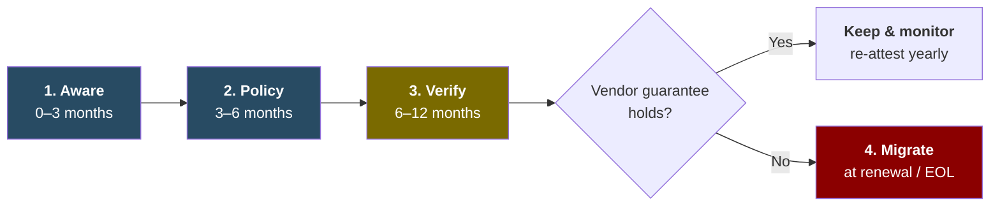

**TLP:GREEN** · 🇲🇾 Malaysia only. Share the link, don't repost. · Strategic assessment · Confidence: Moderate · [[my-only/2026-10-larangan-waze-teknologi-berkait-israel|Baca dalam Bahasa Malaysia]]

> [!abstract] **BLUF**
> **Waze is banned for civil servants, but the government's networks run on tools with far deeper Israeli links and far more access.**
> - **What happened:** on **20 Oct 2026**, under National Cyber Security Committee (JKSN) decision 3/2026, the Chief Secretary to the Government barred all civil servants from Waze. The PM told the public to switch to the local app **TuJu**.
> - **The government's reason:** Waze is *"subject to Israeli government laws"*, which puts users' data and movements at risk.
> - **Apply that test to everything else** and Waze is near the bottom of the list. Firewalls, privileged-access vaults, SASE, EDR and OT sensors from Israel-founded vendors sit inside ministry and CNII networks, with admin rights and automatic updates.
> - **Don't rip anything out.** Write the rule into policy, make vendors **guarantee in writing that no Malaysian data goes to Israel**, verify it, and **switch only at contract renewal** if they can't.

---

## At a glance

| | |
| --- | --- |
| 🚫 **Banned** | Waze, for all civil servants, effective immediately |
| ⚖️ **The test** | Is Malaysian data **within reach of Israeli law**? |
| 🔓 **Higher-access tools that meet it** | Firewalls, PAM, SASE, EDR, OT monitoring (see below) |
| ☁️ **Hard cases** | Microsoft, Google and AWS: government cloud providers, all with Israeli R&D or contracts |
| ✅ **What to do** | Aware → Policy → Verify → Migrate at renewal |

---

## If Waze fails the test, these fail it first

Ranked by **how much access they have inside your network**, highest first:

| # | Category | Why it matters | Examples with an Israeli nexus |
| --- | --- | --- | --- |
| 1 | **SASE / secure web gateway** | *All* your traffic passes through the vendor's cloud | Cato Networks (Israel HQ). Zscaler and Palo Alto (both run Israeli R&D) |
| 2 | **Privileged access (PAM)** | Holds the passwords to your admin accounts | CyberArk, now Idira (Israel-founded, owned by Palo Alto Networks) |
| 3 | **Firewall / perimeter** | Inline on every connection, vendor-pushed updates | Check Point (Israel HQ). Palo Alto Networks (Israeli founder and R&D) |
| 4 | **EDR / XDR** | Kernel-level agent on every laptop and server | SentinelOne, Cynet, Cybereason (Israel-founded). CrowdStrike (Israel R&D centre) |
| 5 | **OT / IoT monitoring** | Sees inside CNII control systems | Claroty, Armis (Israel-founded). Tenable OT (built on Israeli Indegy) |
| 6 | **Cloud security** | Reads your cloud configs and snapshots | Wiz (now Google), Orca |
| … | **Navigation app** | Location and movement data | **Waze** |

The full vendor list with evidence is in [[#Appendix|Appendix B]].

> [!tip] **What makes this hard**
> Founder nationality is a dead end. Israel's biggest security companies are now owned by US firms, and **Microsoft, Google and AWS**, the government's cloud providers, all have Israeli R&D or Israeli government contracts. **Where your data goes can be checked; who founded the vendor can't be acted on.** That is why the steps below focus on data flows.

---

## What to do: act gradually, not abruptly

Ripping out security tools mid-contract is expensive, leaves gaps attackers love, and can cause the very incident you're trying to avoid (remember [[my-threat-landscape/breaches/2026-06-fortibleed|FortiBleed]]). Do it in phases:

**1. Aware (0–3 months)**
- [ ] List every security and SaaS product with its **current owner**, **where it's developed and supported**, **where its telemetry goes** and **when the contract ends**.
- [ ] Rank them by access, using the table above.
- [ ] Block Waze on official devices through MDM, and apply location-history controls to **all** navigation apps.

**2. Policy (3–6 months)**
- [ ] Add a **data-jurisdiction clause** to procurement and renewal templates: no storage, processing or access of Malaysian data in a restricted jurisdiction.
- [ ] Align with **Act 854** (NCII obligations), NACSA guidance and PDPA cross-border transfer rules.

**3. Verify (6–12 months)**
- [ ] Get a **written guarantee** from each vendor covering:
  - data and telemetry region
  - **no access from Israel** (R&D, support, SOC analysts, sub-processors)
  - sub-processor list with change notice
  - audit reports
  - exit assistance
- [ ] **Check it yourself:** monitor where agents and appliances actually send traffic, and switch off optional "cloud sharing" features.
- [ ] Give **less weight** to guarantees from Israel-headquartered vendors, because a contract can't override their home country's laws.

**4. Migrate (at renewal or end-of-life)**
- [ ] Replace **only** where the guarantee fails. Time it to the renewal date to avoid sunk cost.
- [ ] Run old and new in parallel, rotate every credential the old tool held, and remove vendor remote access.
- [ ] Put local alternatives, including TuJu, through the same security review.

---

## Key judgments

| | Judgment | Confidence |
| --- | --- | --- |
| **KJ-1** | The ban is **very likely** a policy decision justified on data-jurisdiction grounds. **No technical finding about Waze has been published.** | Moderate |
| **KJ-2** | Waze is **almost certainly not** the highest-impact place to apply the government's own test. Security tools are. | High |
| **KJ-3** | A founder-nationality rule can't be applied consistently. A **data-flow rule can**, and any wider policy will **very likely** take that form. | High |
| **KJ-4** | There's a **roughly even chance** of follow-on guidance beyond Waze within 6–12 months. | Low |
| **KJ-5** | Gradual, verified action reduces exposure. **Abrupt replacement creates new risk.** | High |

---

## Why Waze, and why now?

The evidence best fits a **policy decision justified on data-security grounds**:
- The circular cites Waze being Israel-based.
- The PM cited Israeli law and Malaysians' data and movements.
- It was promoted alongside a local alternative.
- It follows the 2026 Israel-bound cargo seizures and the 2023 ban on Israeli shipping.

What argues against a purely technical motive is that **Google Maps**, from the same parent company with the same kind of data, wasn't touched. Iraq has announced a similar Waze ban, and Iran has blocked the app before. The full reasoning is in [[#Appendix|Appendix C]].

> [!warning] **Fair-use note**
> An Israeli link is **not** evidence that a product is malicious or backdoored, and nothing here alleges wrongdoing by any vendor or person. This assessment maps **structural exposure** so Malaysian organisations can respond to a stated government policy. Corrections are welcome via [[tanya-rectifyq/index|Tanya Rectifyq]] and are published transparently ([[methodology|Methodology]]).

---

## Appendix

> [!info]- **A. The directive: what we know**
> | Item | Detail | Status |
> | --- | --- | --- |
> | Issuer | KSN Tan Sri Shamsul Azri Abu Bakar, official notice to the public service | ✅ Utusan, SoyaCincau |
> | Basis | JKSN Meeting No. 3/2026, chaired by PM Anwar Ibrahim | ✅ |
> | Scope | All members of the public service, effective immediately. SGs and Heads of Department to cascade | ✅ |
> | Devices | Official vs personal **not stated** | ⚪ |
> | Coordinator | NACSA, MKN, JPM | ✅ |
> | Public advisory | PM advised all Malaysians to use **TuJu** (Lembaga Lebuhraya Malaysia with Prosignal Consortium) | ✅ FMT, Malay Mail |
> | PM's rationale | Personal data and movement information. Waze is "subject to Israeli government laws". *"The government cannot compromise on the security of Malaysians' data and identities."* | ✅ FMT |
> | Same meeting | MyDigital ID security, risks from autonomous AI | ✅ FMT |
> | Circular text | Not published | ⚪ |
>
> **Background:**
> - Waze was founded in Israel in 2008 and bought by Google in 2013 (~US$1.15b). It was merged into Google Maps' Geo team from 2022, and keeps an Israeli development centre.
> - About **6 million** Malaysians used it monthly (2017 estimate, FMT).
> - An Umno MP raised Waze and Google Maps as a US/Israeli security risk in Parliament in **2015**.

> [!example]- **B. Vendor matrix**
> **Evidence:** ✅ verified (source in Appendix I) · 🟡 reported (vendor bio or single source) · ⚪ not assessed.
> **Vendor docs:** what the vendor's own **privacy notice (PN)** and **sub-processor list (SP)** say about Israel, checked on **21 Oct 2026**. "No mention" in a privacy notice does **not** mean no data goes to Israel. Sub-processor lists and support locations matter more.
>
> **Tier 1: Israel-headquartered**
>
> | Vendor | Nexus | Leadership | Malaysia footprint | Vendor docs (Israel) |
> | --- | --- | --- | --- | --- |
> | **Check Point** | HQ Tel Aviv ✅. Owns Perimeter 81 | CEO **Nadav Zafrir** (ex-commander Unit 8200) ✅. Exec. Chairman **Gil Shwed** (Unit 8200) ✅. Lead independent director Yoav Chelouche (IDF Intelligence Corps) 🟡 | Distributors JM Eastern, Ingram Micro. Exposed devices on Shadowserver | PN: names Israel as a transfer destination ✅. SP: **primary support provided from Israel** ✅ |
> | **Cato Networks** | HQ Tel Aviv ✅ | CEO **Shlomo Kramer** (Unit 8200) ✅ | **Gamuda**: 77 sites, 2,000+ remote users on Cato SASE (Sep 2024) ✅. Shadowserver | PN: **governed exclusively by Israeli law, Tel Aviv courts**. Controller Cato Networks Ltd, Tel Aviv (Feb 2025) ✅ |
> | **Radware** | HQ Tel Aviv 🟡 | ⚪ | ⚪ | PN: no mention. Data stored in EU, US and other regions (Jun 2024) ✅ |
> | **Cymulate** | Israel ✅ | ⚪ | ⚪ | PN: **governed by the laws of the State of Israel** ✅ |
> | **Cybersixgill** | Israel ✅. Now part of BitSight | ⚪ | Via BitSight | Site redirects to BitSight |
> | **Ionix** | Israel/US 🟡 | ⚪ | ⚪ | PN: cites Israel's Privacy Protection Law ✅ |
> | **Cellebrite** | HQ Petah Tikva ✅ | ⚪ | No public evidence of MY use ✅ | ⚪ |
>
> **Tier 2: Israel-founded, HQ abroad, R&D in Israel**
>
> | Vendor | Nexus | Leadership | Malaysia footprint | Vendor docs (Israel) |
> | --- | --- | --- | --- | --- |
> | **CyberArk (now Idira)** | Founded Israel ✅. **Palo Alto Networks since Feb 2026, rebranded Idira May 2026** ✅ | Founder **Udi Mokady** (IDF military intelligence) ✅ | ⚪ | Site now redirects to Palo Alto Networks. PN: no mention |
> | **SentinelOne** | Founded Israel ✅. **Prompt Security (Israel) acquired Sep 2025** ✅ | CEO Tomer Weingarten: IDF service, *not* in a tech or intelligence unit (own interview) ✅ | ⚪ | PN: no mention. SP: **Sentinel Labs Israel Ltd (Tel Aviv)** and Monday.com Ltd (Israel) ✅ |
> | **Snyk** | Founded London/Tel Aviv ✅ | Founders Podjarny, Hefetz, Grander (Unit 8200) ✅. CEO Peter McKay | ⚪ | PN: no mention. SP: **Snyk Israel Limited, technical support** ✅ |
> | **Wiz** | Founded Israel ✅. **Google since Mar 2026** ✅ | CEO **Assaf Rappaport**: Talpiot, Unit 81, captain in Unit 8200 ✅. Co-founders also Unit 8200 ✅ | ⚪ | PN (Google): **Wiz Cloud Ltd is data controller for Israel-origin data** ✅ |
> | **Cybereason** | Founded Israel ✅. **LevelBlue since Nov 2025** ✅ | Founders (Unit 8200) 🟡 | Reseller: Adellence | PN: no mention |
> | **Claroty** | Founded Israel, HQ New York 🟡 | Co-founder Amir Zilberstein (IDF cyber unit) 🟡 | Distributor post on public sector (Ishan Tech) | PN: data **may be transferred to the US and/or Israel** ✅ |
> | **Cynet** | Founded Tel Aviv, HQ Boston ✅ | ⚪ | ⚪ | PN: references Israeli privacy law ✅ |
> | **Varonis** | Israeli founders, R&D Herzliya 🟡 | ⚪ | ⚪ | PN: data **transferred, stored and processed** in countries incl. Israel ✅ |
> | **Orca Security** | Founded Israel 🟡 | ⚪ | ⚪ | PN: **personal data accessed from Israel** ✅ |
> | **Aqua Security** | HQ Ramat Gan. **R&D centre in Hyderabad, India** ✅ | ⚪ | MY employer job ad | PN: service providers in US, Europe, **Israel** ✅ |
> | **Intezer** | Founded Israel 🟡 | CEO Itai Tevet (ex-head IDF CERT) 🟡 | ⚪ | PN: data stored in US, Europe and Israel 🟡 |
> | **Morphisec** | Israel 🟡 | ⚪ | ⚪ | PN: **access from Israel** ✅ |
> | **Coro** | Founded Israel 🟡 | ⚪ | ⚪ | PN: processes data in US, UK, EU, **Israel** ✅ |
> | **Forter** | Founded Israel (fraud prevention) 🟡 | ⚪ | ⚪ | PN: Forter Ltd, Tel Aviv ✅ |
> | **Imperva** | Founded Israel. Thales since 2023 | Co-founder Kramer (Unit 8200) ✅ | ⚪ | PN: no mention |
> | **Armis** | Founded Israel. **ServiceNow since Apr 2026** ✅ | ⚪ | ⚪ | PN: no mention |
> | **Guardicore** | Founded Israel. Akamai since 2021 | ⚪ | ⚪ | ⚪ |
>
> **Tier 3: Non-Israeli, with Israeli acquisitions or R&D**
>
> | Vendor | Nexus | Malaysia footprint | Vendor docs (Israel) |
> | --- | --- | --- | --- |
> | **Palo Alto Networks** | Founder/CTO **Nir Zuk** (Unit 8200) ✅. Israeli acquisitions incl. Cyvera (Cortex XDR), Twistlock, Talon, Dig, **CyberArk** ✅ | Yes. Shadowserver | PN: no mention |
> | **Google** | **Waze**, Siemplify, **Wiz** ✅. Israel R&D. Project Nimbus ✅ | Gov Cloud Framework provider ✅ | PN: no mention (for Wiz, see above) |
> | **Microsoft** | Israel R&D. Adallom, Aorato, Hexadite, CyberX. Cut some IMOD Azure services, Sep 2025 ✅ | Gov Cloud Framework provider ✅ | PN: no mention |
> | **AWS** | Annapurna Labs (Israeli chip design). Project Nimbus ✅ | Gov Cloud Framework provider ✅ | ⚪ |
> | **CrowdStrike** | Israel R&D centre (Ramat Gan). Preempt, Bionic, Flow, Adaptive Shield, **Seraphic (announced Jan 2026)** ✅ | ⚪ | PN: affiliates **CrowdStrike Israel Ltd** and **Flow Security Ltd (Israel)** ✅ |
> | **Zscaler** | Israel R&D. Canonic, Trustdome, Avalor ✅ | ⚪ | SP: **support provided from Israel** among other countries ✅ |
> | **Rapid7** | Alcide, IntSights (2021), Minerva Labs (2023) ✅ | ⚪ | PN: no mention |
> | **Tenable** | Indegy (2019, Tenable OT), Ermetic (2023) ✅ | ⚪ | PN: no mention |
> | **Okta** | Spera (2023), Axiom (2025). Israel R&D centre ✅ | ⚪ | PN: no mention |
> | **BitSight** | Cybersixgill (2024) ✅ | Distributor TecD. Chubb MY partner | PN: no mention |
> | **Cisco** | Israel R&D. Portshift (2020), Lightspin (2023) ✅ | Yes | PN: no mention |
> | **IBM** | IBM Research Haifa. Trusteer 🟡 | Yes | PN: no mention |
>
> **No material Israeli nexus identified:** Fortinet, Trend Micro, Recorded Future (Mastercard), Capgemini. None of their privacy notices mention Israel.

> [!question]- **C. Why Waze? Competing hypotheses**
> | Evidence | H1 Policy signal | H2 Data jurisdiction | H3 Technical finding | H4 Wider review | H5 Promote local app |
> | --- | --- | --- | --- | --- | --- |
> | Circular cites "Israel-based", no technical finding | C | C | I | N | N |
> | PM: "subject to Israeli government laws", data and movements | N | C | N | N | N |
> | Decided at JKSN, coordinated by NACSA | N | C | C | C | N |
> | Google Maps (same parent) untouched | C | N | **I** | N | N |
> | 2026 cargo seizures, 2023 shipping ban | C | N | N | C | N |
> | Only Waze named | C | N | N | I | N |
> | TuJu promoted same day | C | N | N | N | C |
> | MyDigital ID on same agenda | N | C | N | C | N |
> | Iraq and Iran precedents | C | C | N | N | N |
> | **Inconsistencies** | **0** | **0** | **2** | **1** | **0** |
>
> *C = consistent · I = inconsistent · N = neutral.*
>
> **Devil's advocate:** if data jurisdiction were truly the driver, US law (e.g., the CLOUD Act) over Google Maps and the government's cloud providers would be in scope too. That selectivity suggests the jurisdiction argument justifies a policy choice rather than resulting from a data-flow audit. Both are probably true, and for defenders the useful part is that **the test is now public and can be applied to suppliers**.

> [!note]- **D. Key assumptions check**
> | Assumption | Holds? | Why |
> | --- | --- | --- |
> | "Ties to Israel" = measurable risk | ⚠️ Partly | Data jurisdiction is measurable. Nexus alone isn't evidence of malice |
> | Founders' Unit 8200 service is a strong signal | ❌ | Conscription is near-universal. Context only |
> | Dropping Israel-HQ vendors removes Israeli code | ❌ | Much of it is now US-owned |
> | No Israel in privacy policy = no data there | ❌ | Check DPA sub-processors and support access. SentinelOne and Snyk show the gap |
> | A vendor guarantee is enough | ⚠️ | Weaker for Israel-HQ vendors, because a contract can't override home-country law |
> | Local alternatives are safer | ⚠️ | Not assessed. "Local" ≠ "reviewed" |

> [!note]- **E. Nexus tiers**
> | Tier | Definition | Examples |
> | --- | --- | --- |
> | 1 | Israel-headquartered or Israel-controlled | Check Point, Cato, Radware, Cellebrite |
> | 2 | Israel-founded, HQ abroad, core R&D in Israel | SentinelOne, Snyk, Claroty, Varonis |
> | 3 | Non-Israeli firm with Israeli acquisitions or R&D | Palo Alto, Google, CrowdStrike, Zscaler |
> | 4 | Contracts with the Israeli government or military | Google & AWS (Nimbus), Microsoft (IMOD) |
>
> **Risk ≈ tier × access level × where the data goes.**

> [!note]- **F. Indicators to watch**
> | If we see… | It means |
> | --- | --- |
> | Circular text published, or a second circular naming other products | Wider review under way (KJ-4 ↑) |
> | NACSA / Act 854 guidance on data jurisdiction or vendor origin | Data-flow rule taking shape (KJ-3 ✓) |
> | Procurement circular on suppliers' data location | Wider review (KJ-4 ↑) |
> | Technical statement on Waze data flows | Security-led motive (KJ-1 ↓) |
> | Google Maps or others also restricted | Broader jurisdiction test |
> | Vendors publish Malaysia data-residency commitments | Market adapting (KJ-3 ✓) |
> | Nothing beyond Waze in 6–12 months | Signal only (KJ-4 ↓) |
>
> **Still unknown:** the circular's exact text and device scope, and actual government deployments of the vendors above. Malaysia footprint means market presence, not confirmed government use.

> [!note]- **G. Method & estimative language**
> **Techniques used:**
> - Key Assumptions Check
> - Analysis of Competing Hypotheses
> - Structured nexus tiering
> - Admiralty source grading
> - Devil's Advocacy
> - Indicators & Warnings
>
> **Likelihood (ICD 203):** almost no chance (01–05%) · very unlikely (05–20%) · unlikely (20–45%) · roughly even chance (45–55%) · likely (55–80%) · very likely (80–95%) · almost certainly (95–99%). **Confidence** reflects source quality, not probability.

> [!note]- **H. Timeline**
> | Date | Event | Link |
> | --- | --- | --- |
> | 2013-06 | Google acquires Waze | [FMT](https://www.freemalaysiatoday.com/category/nation/2026/10/20/anwar-advises-against-using-waze-over-israel-linked-security-concerns) |
> | 2015-11-26 | Umno MP raises Waze and Google Maps as a US/Israeli threat in Parliament | [Malay Mail](https://www.malaymail.com/news/malaysia/2015/11/26/umno-mp-waze-google-maps-expose-malaysia-to-possible-us-israel-threats/1012269) |
> | 2021-02 | Microsoft, Google, Amazon, TM approved as public-sector cloud providers | [NST](https://www.nst.com.my/news/nation/2021/02/666988/four-csps-build-manage-hyper-scale-data-centres-cloud-services) |
> | 2022-05 | Cloud Framework Agreement signed (MAMPU) | [Business Today](https://www.businesstoday.com.my/2022/05/09/public-sector-data-centre-upgraded-to-mygovcloud/) |
> | 2023-12 | Ban on Israeli-owned/flagged ships and ZIM | [CNN](https://www.cnn.com/2023/12/20/asia/malaysia-israel-shipping-ban-palestine-support-intl-hnk) |
> | 2025-09 | Microsoft disables specified IMOD Azure services | [NBC News](https://www.nbcnews.com/tech/tech-news/microsoft-ends-israel-military-units-access-cloud-service-rcna233723) |
> | 2025-11-25 | LevelBlue completes Cybereason acquisition | [Cybereason](https://www.cybereason.com/press/levelblue-acquires-cybereason) |
> | 2026-02-11 | Palo Alto Networks completes CyberArk acquisition | [SEC 8-K](https://www.sec.gov/Archives/edgar/data/1327567/000119312526045600/d40626dex991.htm) |
> | 2026-03-11 | Google completes Wiz acquisition | [Cleary Gottlieb](https://www.clearygottlieb.com/news-and-insights/news-listing/google-completes-32-billion-acquisition-of-wiz) |
> | 2026-04-20 | ServiceNow completes Armis acquisition | [Verdict](https://www.verdict.co.uk/servicenow-completes-armis-deal/) |
> | 2026-09-15 | PM: no cargo aiding Israel's military via Malaysia | [FMT](https://www.freemalaysiatoday.com/category/nation/2026/09/15/malaysia-won-t-allow-cargo-aiding-israel-s-military-says-anwar) |
> | **2026-10-20** | **Waze barred for civil servants. PM promotes TuJu** | [Utusan](https://www.utusan.com.my/nasional/2026/10/penjawat-awam-dilarang-guna-aplikasi-waze/) · [FMT](https://www.freemalaysiatoday.com/category/nation/2026/10/20/anwar-advises-against-using-waze-over-israel-linked-security-concerns) · [Malay Mail](https://www.malaymail.com/news/malaysia/2026/10/20/from-waze-to-tuju-anwar-backs-local-app-over-data-security-concerns/239923) · [SoyaCincau](https://soyacincau.com/2026/10/21/malaysian-goverment-bans-waze-civil-servants/) |

> [!quote]- **I. References & source grading**
> | Source | Used for | Grade |
> | --- | --- | --- |
> | [Utusan Malaysia](https://www.utusan.com.my/nasional/2026/10/penjawat-awam-dilarang-guna-aplikasi-waze/) | Circular, scope | B2 |
> | [SoyaCincau](https://soyacincau.com/2026/10/21/malaysian-goverment-bans-waze-civil-servants/) | Circular details | B2 |
> | [FMT](https://www.freemalaysiatoday.com/category/nation/2026/10/20/anwar-advises-against-using-waze-over-israel-linked-security-concerns) | PM rationale, Iraq/Iran, user base | B2 |
> | [Malay Mail](https://www.malaymail.com/news/malaysia/2026/10/20/from-waze-to-tuju-anwar-backs-local-app-over-data-security-concerns/239923) | TuJu advisory | B2 |
> | [Palo Alto Networks 8-K](https://www.sec.gov/Archives/edgar/data/1327567/000119312526045600/d40626dex991.htm) | CyberArk | A1 |
> | [24/7 Wall St](https://247wallst.com/investing/2026/05/15/oppenheimer-hikes-palo-alto-networks-price-target-to-275-cyberark-becomes-idira-identity-security-just-got-real/) | CyberArk → Idira | B2 |
> | [Cleary Gottlieb](https://www.clearygottlieb.com/news-and-insights/news-listing/google-completes-32-billion-acquisition-of-wiz) | Wiz | A1 |
> | [NBC News](https://www.nbcnews.com/tech/tech-news/microsoft-ends-israel-military-units-access-cloud-service-rcna233723) | Microsoft / IMOD | A2 |
> | [Cybereason](https://www.cybereason.com/press/levelblue-acquires-cybereason) | LevelBlue | A1 |
> | [Verdict](https://www.verdict.co.uk/servicenow-completes-armis-deal/) | Armis | B2 |
> | [Cato Networks: Gamuda](https://www.catonetworks.com/news/gamuda-transforms-it-operations-with-cato/) · [IT Security Guru](https://www.itsecurityguru.org/2024/09/24/gamuda-transforms-it-operations-with-cato-networks/) | Gamuda deployment | B2 (vendor) |
> | [Check Point leadership](https://www.checkpoint.com/about-us/leadership/) | Zafrir, Shwed, Chelouche | A1 |
> | [Wikipedia: Yoav Chelouche](https://en.wikipedia.org/wiki/Yoav_Chelouche) | Intelligence Corps | C2 |
> | [Fortune](https://fortune.com/2016/09/13/israeli-security-software-cato) | Kramer | B2 |
> | [Globes: Snyk](https://en.globes.co.il/en/article-open-source-security-platform-snyk-raises-70m-1001300189) | Snyk founders | B2 |
> | [Wikipedia: Udi Mokady](https://en.wikipedia.org/wiki/Udi_Mokady) | Mokady | C2 |
> | [Wikipedia: Assaf Rappaport](https://en.wikipedia.org/wiki/Assaf_Rappaport) · [Calcalist: Wiz](https://www.calcalistech.com/ctechnews/article/sjltwsk2kg) | Rappaport, Wiz founders | B2 |
> | [Calcalist: Weingarten interview](https://www.calcalistech.com/ctech/articles/0,7340,L-3917654,00.html) | Weingarten's service | B2 |
> | [SentinelOne 10-Q](https://www.sec.gov/Archives/edgar/data/1583708/000158370825000159/s-20251031.htm) | Prompt Security close | A1 |
> | [Aqua Security contact page](https://www.aquasec.com/about-us/contact-us/) | Hyderabad R&D | A1 |
> | [Globes: CrowdStrike](https://en.globes.co.il/en/article-1001493338) · [Flow](https://en.globes.co.il/en/article-1001467832) · [SecurityWeek: Seraphic](https://www.securityweek.com/crowdstrike-to-acquire-browser-security-firm-seraphic-for-420-million/) | CrowdStrike Israel | B2 |
> | [Globes: Zscaler](https://en.globes.co.il/en/article-1001367956) · [Ynet: Avalor](https://ynetnews.com/business/article/sjapmefaa) | Zscaler Israel | B2 |
> | [Calcalist: Lightspin](https://calcalistech.com/ctechnews/article/sk11dn511113) | Cisco | B2 |
> | [Globes: Axiom](https://en.globes.co.il/en/article-1001519918) · [SecurityWeek: Spera](https://www.securityweek.com/okta-to-acquire-israeli-startup-spera-security/) | Okta | B2 |
> | [Globes: Indegy](https://en.globes.co.il/en/article-1001309487) · [Globes: Ermetic](https://en.globes.co.il/en/article-tenable-confirms-acquisition-of-israeli-cloud-security-co-ermetic-1001457403) | Tenable | B2 |
> | [Boston Globe: IntSights](https://www.bostonglobe.com/2021/07/19/business/rapid7-acquires-israel-founded-cybersecurity-firm-335-million) · [Calcalist: Rapid7](https://www.calcalistech.com/tags/Rapid_7) | Rapid7 | B2 |
> | [Wikipedia: Cynet](https://en.wikipedia.org/wiki/Cynet_(company)) · [SentinelOne](https://en.wikipedia.org/wiki/SentinelOne) · [Cellebrite](https://en.wikipedia.org/wiki/Cellebrite) | Company background | C2 |
> | Vendor privacy notices: [Check Point](https://www.checkpoint.com/privacy/) · [Cato](https://www.catonetworks.com/privacypolicy/) · [Radware](https://www.radware.com/privacypolicy/) · [Cymulate](https://cymulate.com/privacy-policy/) · [Ionix](https://www.ionix.io/privacy-policy/) · [Claroty](https://claroty.com/privacy-policy) · [Cynet](https://www.cynet.com/privacy-policy/) · [Varonis](https://www.varonis.com/privacy-policy) · [Orca](https://orca.security/privacy-policy/) · [Aqua](https://www.aquasec.com/privacy/) · [Morphisec](https://www.morphisec.com/privacy-policy) · [Coro](https://www.coro.net/privacy-policy) · [Forter](https://www.forter.com/privacy-policy/) · [CrowdStrike](https://www.crowdstrike.com/en-us/legal/privacy-notice/) · [Google (Wiz)](https://cloud.google.com/terms/cloud-acquisitions-privacy-notice) | Israel mentions, checked 21 Oct 2026 | A1 |
> | Sub-processor lists: [Check Point](https://www.checkpoint.com/sub-processors-list/) · [SentinelOne](https://www.sentinelone.com/legal/sentinelone-sub-processors/) · [Snyk](https://snyk.io/policies/subprocessors/) · [Zscaler](https://www.zscaler.com/privacy-compliance/subprocessors) | Israeli entities and support | A1 |
> | [Citizen Lab (2018)](https://citizenlab.ca/2018/09/hide-and-seek-tracking-nso-groups-pegasus-spyware-to-operations-in-45-countries/) | NSO: Malaysia not among 45 countries | A1 |
> | [Shadowserver (MY)](https://dashboard.shadowserver.org/statistics/iot-devices/map/?date_range=1&vendor=check+point&geo=MY&data_set=count&scale=log&auto_update=on) | Aggregate MY exposure | A2 |
> | [Globes: Waze](https://en.globes.co.il/en/article-google-cuts-jobs-at-waze-due-to-ads-merger-1001450663) | Waze inside Google | B2 |
>
> *Admiralty: A–F source reliability, 1–6 information credibility.*
