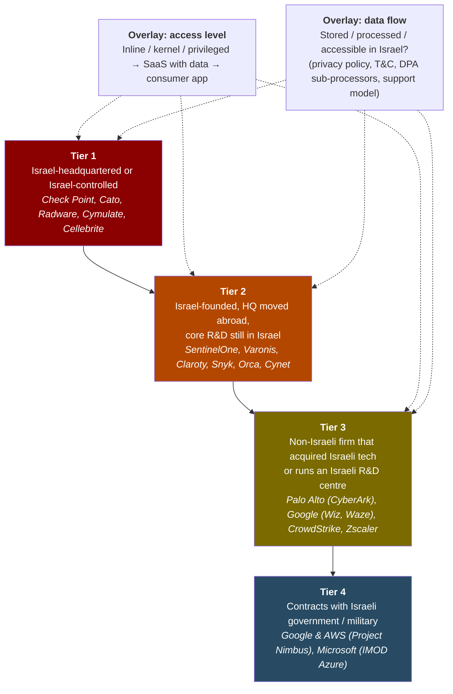
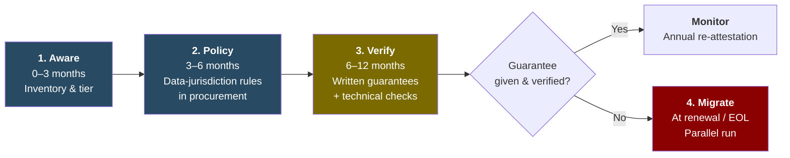

**Status:** Directive corroborated (Utusan, SoyaCincau) · **Type:** Strategic assessment · **Overall confidence:** Moderate · **TLP:GREEN** · 🇲🇾 Malaysia only · [[my-only/2026-10-larangan-waze-teknologi-berkait-israel|Versi Bahasa Malaysia]]

> [!warning] **TLP:GREEN**
> Share within the Malaysian security community and with partner organisations. Do not repost publicly or outside Malaysia. Link to this page instead.

> [!abstract] **BLUF (Bottom Line Up Front)**
> - **Two measures, one day (20 Oct 2026):**
>   - A **binding circular** from the Chief Secretary to the Government (KSN) bars **civil servants** from using **Waze** with immediate effect, under National Cyber Security Committee (JKSN) decision No. 3/2026, coordinated by NACSA.
>   - A **public advisory** from PM Anwar Ibrahim urges all Malaysians to switch to the local app **TuJu**.
> - **The stated rationale is jurisdiction over data.** The PM cited personal data and users' movement information, and said Waze is **subject to Israeli government laws**. Turned around, that is a testable question for every other supplier: **is Malaysian data stored or processed in Israel, or accessible from there?**
> - **By that test, Waze is low on the list.** Israel-headquartered or Israel-founded **security products** (firewalls, privileged-access management, SASE, OT monitoring, EDR) sit inside government and CNII networks. They hold administrator access and auto-update channels, and send telemetry back to the vendor. *(High confidence)*
> - **A founder-nationality test cannot be applied consistently.** The hyperscalers in Malaysia's public-sector Cloud Framework Agreement (**Microsoft, Google, AWS**) all have Israeli R&D, acquisitions or Israeli government contracts, and **Google has owned Waze since 2013**. A **data-flow test is workable**, because it can be checked in contracts and in network traffic. *(High confidence)*
> - **Recommendation: be aware, then act gradually.** Replacing security tooling abruptly is costly and creates risk. Instead, **write it into policy, get written vendor guarantees that no data goes to Israel, and verify them**. Plan any migration **at contract renewal or end-of-life**. See the [[#Apa maksudnya untuk Malaysia? 🇲🇾|phased roadmap]].

---

## Key Intelligence Questions

1. **KIQ-1:** What exactly was decided, for whom, and on what stated basis?
2. **KIQ-2:** Which other technologies in Malaysian public-sector use meet the same test, and how much access do they have?
3. **KIQ-3:** Is the decision driven by a technical finding, jurisdictional data concern, policy and solidarity, or a mix?
4. **KIQ-4:** What follow-on measures are likely, and what should Malaysian defenders do now?

---

## What we know (KIQ-1)

| Item | Detail | Status |
| --- | --- | --- |
| Issuer (binding) | KSN Tan Sri Shamsul Azri Abu Bakar, official notice to the public service | ✅ Corroborated (Utusan, SoyaCincau) |
| Basis | JKSN Meeting No. 3/2026, chaired by PM Anwar Ibrahim | ✅ Corroborated |
| Scope (binding) | All members of the public service, effective immediately. SGs and Heads of Department to cascade to agencies | ✅ Corroborated |
| Device scope | **Official vs personal devices not stated** | ⚪ Gap |
| Reason in circular | Waze "based in Israel" / ties to Israel | ✅ Corroborated |
| Public advisory | PM advised **all Malaysians** against Waze and promoted **TuJu** (by Lembaga Lebuhraya Malaysia, built with Prosignal Consortium) | ✅ FMT, Malay Mail |
| PM's rationale | Personal data and users' movement information. Waze is "subject to Israeli government laws". *"The government cannot compromise on the security of Malaysians' data and identities."* | ✅ FMT |
| Same meeting | MyDigital ID security and risks from autonomous AI | ✅ FMT |
| Coordinator | NACSA, MKN, JPM | ✅ Corroborated |
| Circular number / text | Not published | ⚪ Gap |

**Context:**
- **Waze ownership:** founded in Israel in 2008 and acquired by **Google in June 2013** for about US$1.15 billion. Its team was folded into Google's Geo organisation (Google Maps) from **Dec 2022**, and it keeps a development centre in Israel.
- **Usage:** a 2017 estimate put Malaysia at **about 6 million monthly Waze users**, according to FMT.
- **Regional precedent:** **Iraq** has announced a full Waze ban from early 2027, citing its Israeli origin and data security, and **Iran** has previously restricted the app (both per FMT).
- **Local precedent:** in **2015** an Umno MP told Parliament that Waze and Google Maps exposed Malaysia to possible US and Israeli threats. The government replied that using them was optional (Malay Mail).

---

## Analytic method

| SAT | Purpose here |
| --- | --- |
| **Key Assumptions Check** | Expose what has to be true for a "restrict Israel-linked tech" policy to work |
| **Analysis of Competing Hypotheses (ACH)** | Test *why* Waze was chosen (KIQ-3) |
| **Structured nexus tiering** | Replace "linked / not linked" with graded criteria plus access level (KIQ-2) |
| **Source grading (Admiralty)** | Every reference graded. Vendor bios ≠ independent confirmation |
| **Devil's Advocacy** | Argue the strongest case *against* the leading hypothesis |
| **Indicators & Warnings** | Observable signs that would change the assessment |

> [!info] **Estimative language** (ICD 203)
> almost no chance (01–05%) · very unlikely (05–20%) · unlikely (20–45%) · roughly even chance (45–55%) · likely (55–80%) · very likely (80–95%) · almost certainly (95–99%).
> **Confidence** (High / Moderate / Low) reflects source quality and corroboration, *not* probability.

---

## Key Assumptions Check

| # | Assumption | Holds? | Comment |
| --- | --- | --- | --- |
| A1 | "Ties to Israel" means measurable risk | ⚠️ Partly | The government's own framing is **legal jurisdiction over data**. That *is* measurable (where data sits, who can access it). Nexus alone is **not** evidence of malicious capability |
| A2 | Founders' IDF intelligence service (e.g., Unit 8200) is a strong discriminator | ❌ Weak | Conscription is near-universal in Israel, and 8200 alumni are pervasive in the sector. Useful context, poor sole criterion |
| A3 | Removing Israel-HQ vendors removes Israeli-developed code | ❌ No | Much Israeli-developed technology is **now owned by US firms** (Palo Alto Networks, Google, CrowdStrike, Zscaler, Microsoft, ServiceNow) |
| A4 | A privacy policy that doesn't mention Israel means no data flows there | ❌ No | Check the **DPA sub-processor list**, support "follow-the-sun" access, and R&D access to telemetry and crash dumps. SentinelOne and Snyk list **Israeli entities in their DPAs** while their privacy policies don't mention Israel |
| A5 | A vendor's written guarantee is sufficient | ⚠️ Depends | A contract cannot override compelled-access law **in the vendor's home jurisdiction**. Guarantees from **Tier 1** (Israel-HQ) vendors carry **lower assurance** than from Tier 3 vendors that can ring-fence data outside Israel |
| A6 | The circular covers personal devices | ⚪ Unknown | Not stated |
| A7 | Local alternatives are lower risk | ⚠️ Untested | No public security assessment of TuJu was found. "Local" ≠ "assessed" |

---

## Analysis of Competing Hypotheses (ACH)

**Hypotheses:**
- **H1:** Policy/solidarity signal, consistent with Malaysia's wider measures against Israel.
- **H2:** Jurisdictional data-security concern (Israeli law reaching Malaysian users' data and movements).
- **H3:** Specific technical finding about Waze (vulnerability, incident or telemetry analysis).
- **H4:** Opening move of a broader Israel-nexus technology review.
- **H5:** Industrial policy to promote local platforms (TuJu).

| Evidence | Grade | H1 | H2 | H3 | H4 | H5 |
| --- | --- | --- | --- | --- | --- | --- |
| E1: Circular cites Waze as Israel-based. No vulnerability, incident or data finding cited | B2 | C | C | I | N | N |
| E2: PM cites personal and movement data, and "subject to Israeli government laws" | B2 | N | C | N | N | N |
| E3: Decided at JKSN and coordinated by NACSA (cyber machinery) | B2 | N | C | C | C | N |
| E4: Google Maps and Google Cloud (same parent) **not** in scope | A1 | C | N | **I** | N | N |
| E5: Context in 2026: Israel-bound cargo seizures (Aug), PM's 15 Sep pledge, 2023 ZIM/Israeli-ship ban | A1 | C | N | N | C | N |
| E6: Only Waze named | B2 | C | N | N | I | N |
| E7: TuJu promoted the same day, to the whole public | B2 | C | N | N | N | C |
| E8: Same meeting covered MyDigital ID and AI risks (data-sovereignty agenda) | B2 | N | C | N | C | N |
| E9: Regional precedent (Iraq, Iran) citing Israeli origin and data security | B2 | C | C | N | N | N |
| **Inconsistencies (lower = better)** | | **0** | **0** | **2** | **1** | **0** |

*C = consistent, I = inconsistent, N = neutral.*

**Result:** **H1 and H2 together** best explain the evidence: a **policy decision justified on jurisdictional data-security grounds**. **H5** is a supporting driver. **H3 is least supported**, because no technical finding has been published, and a telemetry-based concern would apply equally to Google Maps. **H4 remains open**, and the indicators below test it.

> [!question] **Devil's Advocacy: the case against H2**
> If jurisdiction over data were the real driver, the same logic reaches **US** law (e.g., the CLOUD Act) over **Google Maps**, Google Cloud and the other Cloud Framework providers, which were not touched. Waze's data is processed by Google, so whether "Israeli law" governs it depends on where that data sits and who can reach it, and that hasn't been shown publicly. This selectivity suggests the jurisdiction argument is **the justification for a policy choice (H1)** rather than the result of a data-flow audit. *Our view:* both are true at once. For defenders, what matters is that **the government has publicly adopted a data-jurisdiction test**, and that test can be applied to suppliers.

---

## Structured nexus tiering (KIQ-2)

**Risk ≈ Nexus tier × Access level × Data flow.** A Tier 3 firewall inline on a ministry network that sends telemetry to an Israeli R&D team deserves more scrutiny than a Tier 1 tool with contractually ring-fenced, in-region data.

---

## Verified vendor matrix

**Legend:**
- ✅ Verified in this review (source cited)
- 🟡 Reported (vendor bio, secondary, or single source)
- ❌ Earlier draft claim not supported / corrected
- ⚪ Not assessed

**Legal docs** = Israel mentioned in **Privacy Policy / T&C-ToU-EULA / DPA (sub-processors)**, from Rectifyq's own document review (Y = yes, N = no, – = not checked). These have not been re-checked for this version, and vendors update these documents often.

### Tier 1: Israel-headquartered

| Vendor | Israel nexus | Leadership intel-unit link | Malaysia evidence | Legal docs | Notes / corrections |
| --- | --- | --- | --- | --- | --- |
| **Check Point** | HQ Tel Aviv (US HQ San Carlos) ✅. Acquired Perimeter 81 (2023) | **Nadav Zafrir**, CEO since Dec 2024, ex-Unit 8200 commander ✅. **Gil Shwed**, Exec. Chairman, Unit 8200 ✅ | Distributors JM Eastern, Ingram Micro MY. Aggregate MY exposure on Shadowserver | Y / Y / – | ❌ Jerry Ungerman as Chairman is stale. ❌ **Amnon Shoshani is a CyberArk director, not Check Point.** His "IDF Spokesperson's Unit" link is unsupported. Yoav Chelouche Intelligence Corps 🟡 |
| **Cato Networks** | HQ Tel Aviv ✅ | **Shlomo Kramer**, co-founder/CEO, Unit 8200 ✅. Gur Shatz: none found | Customer story naming Gamuda 🟡. Shadowserver MY exposure | Y / – / – | SASE: **all traffic transits the vendor cloud** |
| **Radware** | HQ Tel Aviv 🟡 | ⚪ | ⚪ | N / Y / – | DDoS/WAF, inline |
| **Cymulate** | Israel-founded/HQ 🟡 | ⚪ | ⚪ | Y / Y / – | Breach & attack simulation: **agents run attacks inside your network** |
| **Cybersixgill** | Israel ✅. **Acquired by BitSight (2024)** | ⚪ | Via BitSight | Y / Y / – | Threat intel |
| **Ionix** (ex-Cyberpion) | Israel/US 🟡 | ⚪ | ⚪ | Y / Y / – | Attack-surface management |
| **Cellebrite** *(added)* | HQ Petah Tikva ✅. Largest shareholder Sun Corp (Japan) | ⚪ | **No public evidence of MY use found** ✅ | – | Listed for completeness, no MY claim made |

### Tier 2: Israel-founded, HQ abroad, core R&D in Israel

| Vendor | Israel nexus | Leadership intel-unit link | Malaysia evidence | Legal docs | Notes / corrections |
| --- | --- | --- | --- | --- | --- |
| **CyberArk** | Founded Petah Tikva ✅. **Owned by Palo Alto Networks since 11 Feb 2026** ✅ | **Udi Mokady**, founder, IDF military intelligence ✅. "Unit 8200" 🟡 | ⚪ | Indirect (office) / Y / – | PAM: **holds the keys to admin accounts**. ❌ "Gadi Tirosh – likely IDF" removed as non-informative |
| **SentinelOne** | Founded Israel 2013 ✅. Acquired Prompt Security 🟡 | Tomer Weingarten: ❌ military link **not found** in sources | ⚪ | N / N / **Y (Prompt Security Ltd, Israel)** | EDR, kernel agent. **Clear case for A4**: the DPA shows what the privacy policy doesn't |
| **Snyk** | Founded London & Tel Aviv 2015, HQ Boston ✅. Acquired Helios 🟡 | **Podjarny, Hefetz, Grander**: Unit 8200 ✅ | ⚪ | N / N / **Y (Snyk Israel Ltd)** | ❌ **CEO is Peter McKay (since 2019)**, not Podjarny |
| **Wiz** | Israel-founded ✅. **Owned by Google since 11 Mar 2026** ✅ | All four co-founders Unit 8200 🟡 | ⚪ | Y / N / – | ❌ "Talpiot" for Rappaport not verified |
| **Cybereason** | Founded Israel 2012 ✅. **Owned by LevelBlue since 25 Nov 2025** ✅ | Founders Div, Naar, Striem-Amit: Unit 8200 🟡 | Reseller (Adellence) | N / N / – | ❌ Founders, not the ex-CISO, are the relevant link |
| **Claroty** | Israel-founded (Team8), HQ New York 🟡 | Amir Zilberstein, "elite IDF cyber unit" 🟡 | Distributor post on **public sector** (Ishan Tech) | Y / Y / – | **OT/CNII monitoring**, see [[ics-ot/index\|ICS/OT]] |
| **Cynet** | Founded Tel Aviv 2015, HQ Boston ✅ | ❌ Eyal Gruner "Unit 8200" **not supported** | ⚪ | Y / Y / – | EDR/XDR |
| **Varonis** | Founded by Faitelson & Korkus, R&D Herzliya 🟡 | ⚪ | ⚪ | Y / N / – | Reads file permissions and content |
| **Orca Security** | Israel-founded 🟡 | ⚪ | ⚪ | Y / Y / – | Cloud security (reads cloud snapshots) |
| **Aqua Security** | Israel HQ (Ramat Gan). R&D in India per our collection 🟡 | Dror Davidoff (CEO): none identified | Demand side only: MY employer job ad | Y / Y / – | MY presence: none found |
| **Intezer** | Israel-founded, HQ New York 🟡 | **Itai Tevet**, ex-head of IDF CERT 🟡 | ⚪ | Y / Y / – | |
| **Morphisec** | Israel-founded/HQ (Be'er Sheva) 🟡 | ⚪ | ⚪ | Y / Y / – | Endpoint |
| **Coro** | Israel-founded (Coronet), HQ Chicago 🟡 | ⚪ | ⚪ | Y / Y / – | SME security |
| **Forter** | Israel-founded, HQ New York 🟡 | ⚪ | ⚪ | Y (office address) / N / – | Fraud prevention. **Low gov relevance** |
| **Imperva** *(added)* | Israel-founded. **Owned by Thales (France) since 2023** | Kramer (co-founder): Unit 8200 ✅ | ⚪ | – | WAF/DDoS, inline |
| **Armis** *(added)* | Israel-founded. **Owned by ServiceNow since 20 Apr 2026** ✅ | ⚪ | ⚪ | – | IoT/OT/medical: **CNII relevance** |
| **Guardicore** *(added)* | Israel-founded. Owned by Akamai (2021) | ⚪ | ⚪ | – | Micro-segmentation |

### Tier 3: non-Israeli firms with Israeli acquisitions or R&D

| Vendor | Israel nexus | Malaysia evidence | Legal docs | Notes / corrections |
| --- | --- | --- | --- | --- |
| **Palo Alto Networks** | Founder/CTO **Nir Zuk**, ex-Unit 8200 ✅. Israeli acquisitions: Cyvera (basis of Cortex XDR), LightCyber, Secdo, Twistlock, PureSec, Cider, Talon, Dig, **CyberArk (2026)** ✅. Planned Tel Aviv secondary listing ✅ | Yes. Shadowserver MY exposure | – | ❌ **Duplicate rows merged.** Now the **densest Israeli-nexus portfolio** of any US vendor |
| **Google** | **Waze** (2013), Siemplify (2022), **Wiz** (2026) ✅. Israel R&D. **Project Nimbus** (Tier 4) ✅ | **Cloud Framework Agreement provider** ✅ | N / N / – | ❌ Waze and Nimbus were missing |
| **Microsoft** | Israel R&D centre. Adallom, Aorato, Hexadite, CyberX (→ Defender for IoT). **Sep 2025: disabled specified IMOD subscriptions** ✅ | **Cloud Framework Agreement provider** ✅. Major MY investment | – | ❌ Unsourced footnote "54" replaced with Microsoft's own statement |
| **AWS** *(added)* | **Annapurna Labs** (Israeli, 2015, designs Nitro/Graviton chips). **Project Nimbus** ✅ | **Cloud Framework Agreement provider** ✅ | – | New row |
| **CrowdStrike** | **Israel R&D centre (Ramat Gan)** ✅. Preempt, Bionic, Flow Security, Adaptive Shield ✅. Seraphic 🟡 | ⚪ | Y (branch companies) / N / – | ❌ R&D "Israel (Likely)" now **confirmed** |
| **Zscaler** | Canonic, **Trustdome (2021, first Israel R&D centre)**, **Avalor (2024)** ✅ | ⚪ | Y (affiliates) / – / – | ❌ R&D "No (based on snippets)" **corrected** |
| **Rapid7** | Israel branch. IntSights, Alcide, Minerva Labs 🟡 | ⚪ | N / N / – | As drafted |
| **Tenable** | **Indegy (2019, basis of Tenable OT)**, Ermetic (2023) 🟡 | ⚪ | N / N / – | Indegy added (OT) |
| **Okta** | Spera (2024), Axiom (2025) 🟡 | ⚪ | N / N / – | As drafted |
| **BitSight** | Israel branch via **Cybersixgill (2024)** ✅ | Distributor TecD Malaysia. Chubb MY cyber services | N / – / – | MY presence via partners, not a local entity |
| **Cisco** | Israel R&D centres. Israeli acquisitions (e.g., Portshift, Lightspin) 🟡 | Yes | N / N / – | ❌ R&D "N/A" corrected. ❌ "Deep partnership with Israeli military" (fn 45) **unsourced, removed** |
| **IBM** | **IBM Research Haifa**. Trusteer (2013) 🟡 | Yes | Y (extra rights for Israeli customers) / N / – | ❌ "No presence in Israel" **corrected**. ❌ "Population registry" (fn 49) **unsourced, removed** |

### No material Israeli nexus identified

| Vendor | Legal docs | Note |
| --- | --- | --- |
| **Fortinet** | N / N / – | US. No Israeli founding or major Israeli acquisition identified |
| **Trend Micro** | N / N / – | Japan. Eva Chen co-founder/CEO |
| **Recorded Future** | N / N / – | US. **Owned by Mastercard (Dec 2024)** |
| **Capgemini** | N / N / – | France. ❌ "Might draw upon Israeli collaborations" and the Sogeti link were **speculative**. Re-add only with a sourced Israeli entity or contract |

### Not yet assessed (collection list)

- **Israel-founded vendors with a plausible MY footprint:** Silverfort, Pentera, XM Cyber (Schwarz Group), Cyera, Axonius, Transmit Security, Island, Perimeter 81 (now Check Point Harmony SASE), Talon (now Prisma Access Browser).
- **Hardware layer** (out of scope, but material to KJ-3): NVIDIA networking (ex-Mellanox), Intel (Israel R&D/fabs), AWS Annapurna silicon.

---

## Key Judgments

> [!important] **KJ-1: A policy decision justified on data-jurisdiction grounds** *(Moderate confidence)*
> The Waze directive is **very likely** a policy decision (H1) justified on **jurisdictional data-security grounds** (H2), with local-platform promotion as a secondary driver (H5). **No Waze-specific technical finding has been published** (High confidence), and the Google Maps carve-out makes a telemetry-driven finding (H3) **unlikely**.

> [!important] **KJ-2: Waze is low on the access ladder** *(High confidence)*
> Tier 1–2 security products in government and CNII use hold **administrator credentials, kernel-level agents, inline traffic position and auto-update channels**, and often send telemetry to Israeli R&D teams. If the policy aim is to keep Malaysian data out of Israeli jurisdiction, **Waze is almost certainly not the highest-impact place to apply it**.

> [!important] **KJ-3: Data-flow tests work, nationality tests don't** *(High confidence)*
> A founder- or ownership-based test cannot be applied consistently. Every Cloud Framework hyperscaler and most market-leading US security vendors meet at least one tier. The government's **stated** test, Israeli jurisdiction over Malaysian data, *can* be applied: it is checkable through **DPAs, sub-processor lists, data-residency commitments and egress monitoring**. Any extension of policy will **very likely** be tiered and data-flow based.

> [!important] **KJ-4: Further measures are a roughly even chance** *(Low confidence)*
> There is a **roughly even chance** that JKSN or NACSA issues follow-on guidance extending scrutiny beyond Waze within **6–12 months**.
> - **Pointing up:** the PM's public data-sovereignty framing, the MyDigital ID agenda at the same meeting, and regional precedent (Iraq).
> - **Pointing down:** only Waze was named, and replacing security stacks is costly.

> [!important] **KJ-5: Gradual, verified action beats rip-and-replace** *(High confidence)*
> Unplanned removal of EDR, firewall or PAM tooling causes **coverage gaps, misconfigurations and credential sprawl**, and the replacement cost lands mid-contract. Threat actors routinely exploit transition periods (see [[my-threat-landscape/breaches/2026-06-fortibleed|FortiBleed]]). A **policy → verify → migrate-at-renewal** path reduces exposure without creating a new incident.

---

## Apa maksudnya untuk Malaysia? 🇲🇾

**Stance:** be aware now, put it into policy, verify vendor guarantees, and migrate **only where guarantees fail, at renewal**.

### Phase 1: Aware (0–3 months)
- **Build a vendor-nexus register.** For each product, record:
  - current owner and HQ
  - development and support locations
  - telemetry destinations and update channel
  - contract end date
- Apply the tiers above, and note the 2025–26 ownership changes (CyberArk, Wiz, Cybereason, Armis).
- **Rank by access level:**
  1. Inline and privileged tools (SASE, firewall, PAM, EDR, OT sensors)
  2. SaaS holding government data
  3. Apps on officials' devices
- **Officials' devices:** enforce the Waze directive with an MDM app blocklist. Apply **location-history controls to all navigation apps**, not only Waze.

### Phase 2: Policy (3–6 months)
- Add **data-jurisdiction clauses** to procurement and renewal templates. Malaysian data and telemetry must not be stored, processed or accessed in a restricted jurisdiction.
- Align with **Cyber Security Act 2024 (Act 854)** obligations for NCII entities, NACSA guidance, and **PDPA cross-border transfer** provisions.
- Make **new purchases** of Tier 1–2 products in privileged roles require a documented exception.

### Phase 3: Verify (6–12 months)
Ask each in-scope vendor for a **written attestation** covering:
- **Data residency:** storage and processing region for customer data, telemetry, logs, crash dumps and threat-intel submissions.
- **No access from Israel:** this includes R&D, "follow-the-sun" support, SOC/MDR analysts and sub-processors.
- **Sub-processor list**, with **advance notice of changes** and a right to object.
- **Audit rights:** SOC 2 / ISO 27001 reports covering the stated regions.
- **Update integrity:** code-signing, and where builds are produced.
- **Exit assistance:** data return and deletion, and a transition period.

**Then verify technically.** Don't rely on paper alone:
- Monitor agent and appliance **egress destinations** (domains, IP geolocation).
- Turn off optional cloud-sharing features (e.g., sample submission, "community" telemetry) where policy requires.

> [!tip] Weight guarantees by jurisdiction
> An attestation from an **Israel-HQ (Tier 1)** vendor cannot override compelled-access law in its home country, so treat it as **lower assurance** (Assumption A5). Tier 2–3 vendors that can contractually **ring-fence data and support** outside Israel give stronger guarantees.

### Phase 4: Migrate (at renewal or end-of-life)
- Where a guarantee **can't be given or doesn't hold up**, plan the replacement **at the contract renewal point** to avoid sunk cost.
- **Run old and new in parallel**, rotate every credential the outgoing tool held, revoke vendor remote-support access, and confirm detection coverage before cut-over.
- **Assess local alternatives** such as TuJu with the same privacy and security review before mandating them.

---

## Indicators & Warnings

| Indicator | Supports |
| --- | --- |
| Circular text published, or a second circular naming other products or vendors | H4 / KJ-4 ↑ |
| NACSA guidance or Act 854 code-of-practice language on data jurisdiction or vendor origin | H4 / KJ-3 ✓ |
| MOF/procurement circular on suppliers' data location | H4 ↑ |
| Technical statement on Waze data flows (e.g., NACSA analysis) | H3 ↑ (KJ-1 ↓) |
| Google Maps or other non-Israeli navigation apps restricted | H2 broadens / H1 ↓ |
| Vendors publish Malaysia-specific data-residency commitments | KJ-3 ✓ |
| Directive stays limited to Waze with no expansion | H1 ✓ / KJ-4 ↓ |

---

## Intelligence gaps

- Full circular text and **device scope** (official vs personal).
- **Actual deployment** of these vendors inside Malaysian government networks. Malaysia evidence above means *market presence*, not confirmed government use.
- **Current** sub-processor and data-residency terms. Our legal-doc review predates this version.
- Military background for several executives (Chelouche, Weingarten, Gruner) remains **unverified**.
- Whether any technical assessment of Waze sits behind the JKSN decision.

---

## Timeline

| Date | Event | Link |
| --- | --- | --- |
| 2013-06 | Google acquires Waze (~US$1.15b) | [FMT](https://www.freemalaysiatoday.com/category/nation/2026/10/20/anwar-advises-against-using-waze-over-israel-linked-security-concerns) |
| 2015-11-26 | Umno MP tells Parliament that Waze and Google Maps expose Malaysia to US/Israeli threats | [Malay Mail](https://www.malaymail.com/news/malaysia/2015/11/26/umno-mp-waze-google-maps-expose-malaysia-to-possible-us-israel-threats/1012269) |
| 2021-02 | Govt conditionally approves Microsoft, Google, Amazon, TM as public-sector cloud providers | [NST](https://www.nst.com.my/news/nation/2021/02/666988/four-csps-build-manage-hyper-scale-data-centres-cloud-services) |
| 2022-05 | Cloud Framework Agreement signed (MAMPU) | [Business Today](https://www.businesstoday.com.my/2022/05/09/public-sector-data-centre-upgraded-to-mygovcloud/) |
| 2023-12 | Malaysia bans Israeli-owned/flagged ships and ZIM | [CNN](https://www.cnn.com/2023/12/20/asia/malaysia-israel-shipping-ban-palestine-support-intl-hnk) |
| 2025-09 | Microsoft disables specified IMOD Azure subscriptions | [NBC News](https://www.nbcnews.com/tech/tech-news/microsoft-ends-israel-military-units-access-cloud-service-rcna233723) |
| 2025-11-25 | LevelBlue completes Cybereason acquisition | [Cybereason](https://www.cybereason.com/press/levelblue-acquires-cybereason) |
| 2026-02-11 | Palo Alto Networks completes CyberArk acquisition | [SEC 8-K](https://www.sec.gov/Archives/edgar/data/1327567/000119312526045600/d40626dex991.htm) |
| 2026-03-11 | Google completes Wiz acquisition | [Cleary Gottlieb](https://www.clearygottlieb.com/news-and-insights/news-listing/google-completes-32-billion-acquisition-of-wiz) |
| 2026-04-20 | ServiceNow completes Armis acquisition | [Verdict](https://www.verdict.co.uk/servicenow-completes-armis-deal/) |
| 2026-09-15 | PM: Malaysia won't be a conduit for cargo aiding Israel's military | [FMT](https://www.freemalaysiatoday.com/category/nation/2026/09/15/malaysia-won-t-allow-cargo-aiding-israel-s-military-says-anwar) |
| **2026-10-20** | **JKSN 3/2026 → KSN notice bars civil servants from Waze. PM advises public to use TuJu** | [Utusan](https://www.utusan.com.my/nasional/2026/10/penjawat-awam-dilarang-guna-aplikasi-waze/) · [FMT](https://www.freemalaysiatoday.com/category/nation/2026/10/20/anwar-advises-against-using-waze-over-israel-linked-security-concerns) · [Malay Mail](https://www.malaymail.com/news/malaysia/2026/10/20/from-waze-to-tuju-anwar-backs-local-app-over-data-security-concerns/239923) |
| 2026-10-21 | Circular contents reported | [SoyaCincau](https://soyacincau.com/2026/10/21/malaysian-goverment-bans-waze-civil-servants/) |

---

## References & source grading

| Source | Used for | Grade |
| --- | --- | --- |
| [Utusan Malaysia, Oct 2026](https://www.utusan.com.my/nasional/2026/10/penjawat-awam-dilarang-guna-aplikasi-waze/) | Circular, scope, coordinators | B2 |
| [SoyaCincau, 21 Oct 2026](https://soyacincau.com/2026/10/21/malaysian-goverment-bans-waze-civil-servants/) | Circular details | B2 |
| [FMT, 20 Oct 2026](https://www.freemalaysiatoday.com/category/nation/2026/10/20/anwar-advises-against-using-waze-over-israel-linked-security-concerns) | PM rationale and quote, Iraq/Iran, user base | B2 |
| [Malay Mail, 20 Oct 2026](https://www.malaymail.com/news/malaysia/2026/10/20/from-waze-to-tuju-anwar-backs-local-app-over-data-security-concerns/239923) | Public TuJu advisory | B2 |
| [Malay Mail, 26 Nov 2015](https://www.malaymail.com/news/malaysia/2015/11/26/umno-mp-waze-google-maps-expose-malaysia-to-possible-us-israel-threats/1012269) | Parliamentary precedent | B2 |
| [Palo Alto Networks 8-K](https://www.sec.gov/Archives/edgar/data/1327567/000119312526045600/d40626dex991.htm) | CyberArk close, TASE listing | A1 |
| [Cleary Gottlieb](https://www.clearygottlieb.com/news-and-insights/news-listing/google-completes-32-billion-acquisition-of-wiz) | Wiz close | A1 |
| [NBC News](https://www.nbcnews.com/tech/tech-news/microsoft-ends-israel-military-units-access-cloud-service-rcna233723) | Microsoft / IMOD | A2 |
| [Cybereason press](https://www.cybereason.com/press/levelblue-acquires-cybereason) | LevelBlue close | A1 |
| [Verdict](https://www.verdict.co.uk/servicenow-completes-armis-deal/) | Armis close | B2 |
| [CyberArk: Amnon Shoshani bio](https://www.cyberark.com/?p=124456) | Correction (CyberArk, not Check Point) | A1 |
| [Check Point leadership](https://www.checkpoint.com/about-us/leadership/) | Zafrir CEO, Shwed Exec. Chairman | A1 |
| [Fortune, 2016](https://fortune.com/2016/09/13/israeli-security-software-cato) | Kramer, Unit 8200 | B2 |
| [Globes: Snyk](https://en.globes.co.il/en/article-open-source-security-platform-snyk-raises-70m-1001300189) | Snyk founders, Unit 8200 | B2 |
| [Wikipedia: Udi Mokady](https://en.wikipedia.org/wiki/Udi_Mokady) / [SC Magazine](https://www.scmagazine.com/feature/influencer-udi-mokady) | Mokady, military intelligence | C2 / B3 |
| [Calcalist: Wiz](https://www.calcalistech.com/ctechnews/article/sjltwsk2kg) | Wiz founders, Unit 8200 | B2 |
| [Globes: CrowdStrike / Adaptive Shield](https://en.globes.co.il/en/article-1001493338) · [Flow](https://en.globes.co.il/en/article-1001467832) | CrowdStrike Israel R&D | B2 |
| [Globes: Zscaler / Trustdome](https://en.globes.co.il/en/article-1001367956) · [Ynet: Avalor](https://ynetnews.com/business/article/sjapmefaa) | Zscaler Israel R&D | B2 |
| [Wikipedia: Cynet](https://en.wikipedia.org/wiki/Cynet_(company)) | Cynet founding, HQ | C2 |
| [Wikipedia: SentinelOne](https://en.wikipedia.org/wiki/SentinelOne) | Founders | C2 |
| [Wikipedia: Cellebrite](https://en.wikipedia.org/wiki/Cellebrite) | HQ, ownership | C2 |
| [Citizen Lab, Hide and Seek (2018)](https://citizenlab.ca/2018/09/hide-and-seek-tracking-nso-groups-pegasus-spyware-to-operations-in-45-countries/) | NSO: **Malaysia not among the 45 countries** | A1 |
| [Shadowserver IoT dashboard (MY)](https://dashboard.shadowserver.org/statistics/iot-devices/map/?date_range=1&vendor=check+point&geo=MY&data_set=count&scale=log&auto_update=on) | Aggregate MY exposure (Check Point, Cato, Palo Alto) | A2 |
| [Globes: Waze / Google ads merger](https://en.globes.co.il/en/article-google-cuts-jobs-at-waze-due-to-ads-merger-1001450663) | Waze integration into Google | B2 |
| [Lowyat: TuJu launch](https://forum.lowyat.net/topic/5547580) | TuJu background | C3 |
| Rectifyq vendor legal-document review (2026) | Privacy policy / T&C / DPA mentions | B3 (internal, not re-checked) |

*Admiralty: A–F source reliability, 1–6 information credibility.*

> [!warning] **Scope & fair-use note**
> An Israeli nexus is **not** evidence that a product is malicious, backdoored or unlawful, and nothing here alleges wrongdoing by any vendor or individual. This assessment maps **structural exposure** to help Malaysian organisations respond to a stated government policy. Vendors and readers can submit corrections via [[tanya-rectifyq/index|Tanya Rectifyq]]. Corrections are published transparently ([[methodology|Methodology]] rule 7).

*Updates appended as status changes.*
